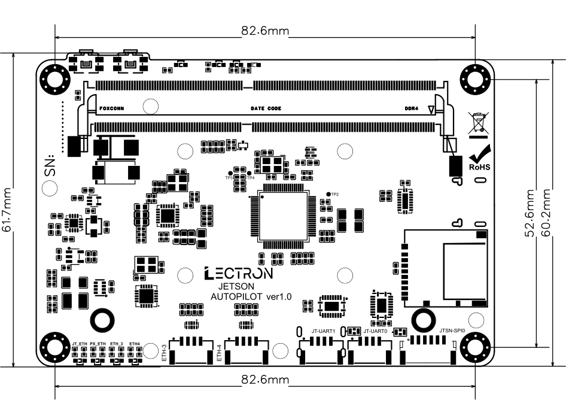
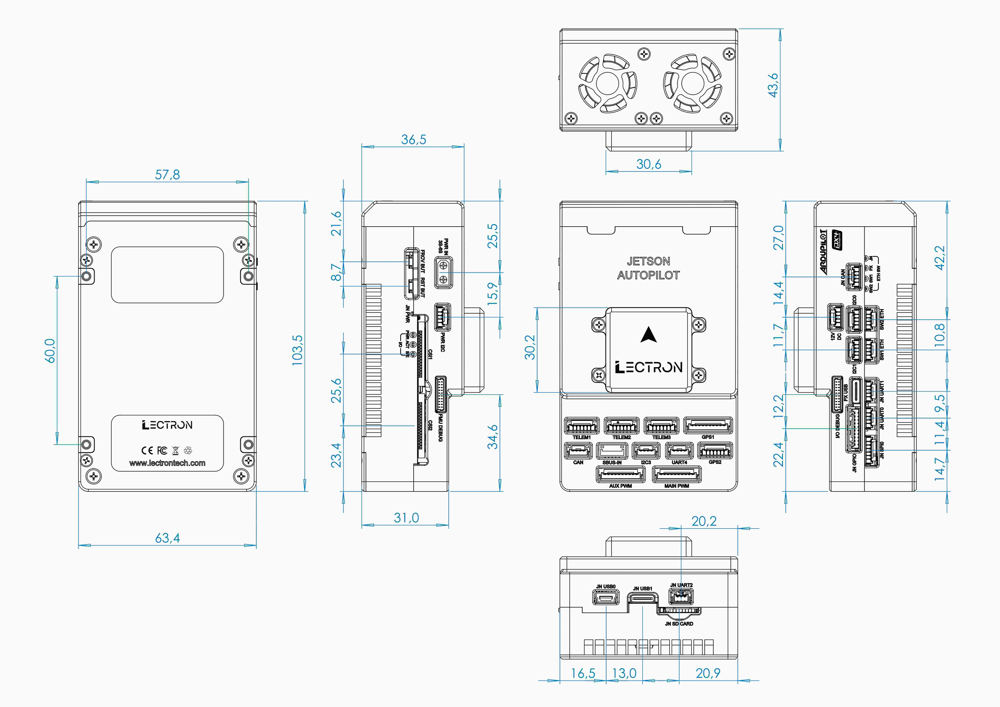

# Dimensions

<svg class="dim-svg" viewBox="0 0 629 443" role="img" aria-label="Jetson baseboard dimensions, top view" xmlns="http://www.w3.org/2000/svg">
  <rect class="dim-outline" x="78.0" y="59.8" width="469.0" height="313.0" rx="18.2"/>
  <rect class="dim-part" x="111.8" y="52.0" width="33.3" height="14.0" rx="2.1"/>
  <rect class="dim-part" x="157.6" y="52.0" width="34.8" height="14.0" rx="2.1"/>
  <rect class="dim-part" x="120.6" y="81.1" width="385.3" height="58.2" rx="3.1"/>
  <rect class="dim-part" x="120.6" y="81.1" width="20.3" height="69.2" rx="2.6"/>
  <rect class="dim-part" x="485.7" y="81.1" width="20.3" height="69.2" rx="2.6"/>
  <rect class="dim-pins" x="145.1" y="83.2" width="337.0" height="6.8" rx="0.0"/>
  <rect class="dim-pins" x="145.1" y="124.8" width="337.0" height="6.8" rx="0.0"/>
  <text class="dim-part-label" x="313.3" y="110.2" text-anchor="middle" dominant-baseline="middle">260-PIN SODIMM</text>
  <rect class="dim-pins" x="303.7" y="190.3" width="56.2" height="56.2" rx="0.0"/>
  <rect class="dim-chip" x="308.4" y="195.0" width="46.8" height="46.8" rx="1.6"/>
  <text class="dim-part-label dim-part-label--strong" x="331.8" y="218.4" text-anchor="middle" dominant-baseline="middle">FMU</text>
  <text class="dim-part-label" x="331.8" y="257.4" text-anchor="middle" dominant-baseline="middle">STM32H753</text>
  <rect class="dim-part" x="454.0" y="232.4" width="85.8" height="79.0" rx="3.1"/>
  <text class="dim-part-label" x="496.9" y="272.0" text-anchor="middle" dominant-baseline="middle">SD CARD</text>
  <rect class="dim-part" x="213.7" y="343.7" width="45.2" height="28.1" rx="2.1"/>
  <text class="dim-part-label dim-part-label--small" x="236.3" y="333.3" text-anchor="middle" dominant-baseline="middle">ETH-3</text>
  <rect class="dim-part" x="270.4" y="343.7" width="46.3" height="28.1" rx="2.1"/>
  <text class="dim-part-label dim-part-label--small" x="293.5" y="333.3" text-anchor="middle" dominant-baseline="middle">ETH-4</text>
  <rect class="dim-part" x="346.8" y="343.7" width="46.3" height="28.1" rx="2.1"/>
  <text class="dim-part-label dim-part-label--small" x="370.0" y="333.3" text-anchor="middle" dominant-baseline="middle">JT-UART1</text>
  <rect class="dim-part" x="395.7" y="343.7" width="46.3" height="28.1" rx="2.1"/>
  <text class="dim-part-label dim-part-label--small" x="418.9" y="333.3" text-anchor="middle" dominant-baseline="middle">JT-UART0</text>
  <rect class="dim-part" x="449.3" y="343.7" width="57.7" height="28.1" rx="2.1"/>
  <text class="dim-part-label dim-part-label--small" x="478.1" y="333.3" text-anchor="middle" dominant-baseline="middle">JTSN-SPI0</text>
  <circle class="dim-hole" cx="97.8" cy="353.1" r="8.3"/>
  <path class="dim-center" d="M85.4 353.1H110.1M97.8 340.8V365.4"/>
  <circle class="dim-hole" cx="97.8" cy="79.6" r="8.3"/>
  <path class="dim-center" d="M85.4 79.6H110.1M97.8 67.2V91.9"/>
  <circle class="dim-hole" cx="527.3" cy="353.1" r="8.3"/>
  <path class="dim-center" d="M515.0 353.1H539.6M527.3 340.8V365.4"/>
  <circle class="dim-hole" cx="527.3" cy="79.6" r="8.3"/>
  <path class="dim-center" d="M515.0 79.6H539.6M527.3 67.2V91.9"/>
  <path class="dim-ext" d="M97.8 75.6V20.0"/>
  <path class="dim-ext" d="M527.3 75.6V20.0"/>
  <path class="dim-line" d="M97.8 26.0H527.3"/>
  <path class="dim-arrow" d="M97.8 26.0L104.8 23.4L104.8 28.6Z"/>
  <path class="dim-arrow" d="M527.3 26.0L520.3 28.6L520.3 23.4Z"/>
  <text class="dim-label" x="312.5" y="21.0" text-anchor="middle">82.6</text>
  <path class="dim-ext" d="M531.3 353.1H587.0"/>
  <path class="dim-ext" d="M531.3 79.6H587.0"/>
  <path class="dim-line" d="M581.0 353.1V79.6"/>
  <path class="dim-arrow" d="M581.0 353.1L578.4 346.1L583.6 346.1Z"/>
  <path class="dim-arrow" d="M581.0 79.6L583.6 86.6L578.4 86.6Z"/>
  <text class="dim-label" x="576.0" y="216.3" text-anchor="middle" transform="rotate(-90 576.0 216.3)">52.6</text>
  <path class="dim-ext" d="M551.0 372.8H615.0"/>
  <path class="dim-ext" d="M551.0 59.8H615.0"/>
  <path class="dim-line" d="M609.0 372.8V59.8"/>
  <path class="dim-arrow" d="M609.0 372.8L606.4 365.8L611.6 365.8Z"/>
  <path class="dim-arrow" d="M609.0 59.8L611.6 66.8L606.4 66.8Z"/>
  <text class="dim-label" x="604.0" y="216.3" text-anchor="middle" transform="rotate(-90 604.0 216.3)">60.2</text>
  <path class="dim-ext" d="M74.0 372.8H42.0"/>
  <path class="dim-ext" d="M107.8 52.0H42.0"/>
  <path class="dim-line" d="M48.0 372.8V52.0"/>
  <path class="dim-arrow" d="M48.0 372.8L45.4 365.8L50.6 365.8Z"/>
  <path class="dim-arrow" d="M48.0 52.0L50.6 59.0L45.4 59.0Z"/>
  <text class="dim-label" x="43.0" y="212.4" text-anchor="middle" transform="rotate(-90 43.0 212.4)">61.7</text>
  <text class="dim-note" x="312.5" y="412.8" text-anchor="middle">TOP VIEW · mm</text>
</svg>

01 Baseboard

| | |
| --- | --- |
| PCB height | 60.2 mm |
| Height incl. connectors | 61.7 mm |
| Mounting hole spacing | 82.6 × 52.6 mm |
| Mounting holes | 4 |

All dimensions in mm. Hole spacing is centre to centre. Component outlines are approximate and shown for orientation.

<svg class="dim-svg" viewBox="0 0 640 454" role="img" aria-label="Jetson Autopilot case dimensions, top and side view" xmlns="http://www.w3.org/2000/svg">
  <rect class="dim-outline" x="104.0" y="64.0" width="198.4" height="323.9" rx="9.4"/>
  <rect class="dim-part dim-part--raised" x="155.3" y="185.1" width="95.8" height="94.5" rx="4.7"/>
  <text class="dim-part-label dim-part-label--strong" x="203.2" y="232.4" text-anchor="middle" dominant-baseline="middle">MODULE COVER</text>
  <circle class="dim-hidden" cx="112.8" cy="334.7" r="5.0"/>
  <path class="dim-center" d="M103.8 334.7H121.8M112.8 325.7V343.7"/>
  <circle class="dim-hidden" cx="112.8" cy="146.9" r="5.0"/>
  <path class="dim-center" d="M103.8 146.9H121.8M112.8 137.9V155.9"/>
  <circle class="dim-hidden" cx="293.6" cy="334.7" r="5.0"/>
  <path class="dim-center" d="M284.6 334.7H302.6M293.6 325.7V343.7"/>
  <circle class="dim-hidden" cx="293.6" cy="146.9" r="5.0"/>
  <path class="dim-center" d="M284.6 146.9H302.6M293.6 137.9V155.9"/>
  <path class="dim-ext" d="M112.8 142.9V18.0"/>
  <path class="dim-ext" d="M293.6 142.9V18.0"/>
  <path class="dim-line" d="M112.8 24.0H293.6"/>
  <path class="dim-arrow" d="M112.8 24.0L119.8 21.4L119.8 26.6Z"/>
  <path class="dim-arrow" d="M293.6 24.0L286.6 26.6L286.6 21.4Z"/>
  <text class="dim-label" x="203.2" y="19.0" text-anchor="middle">57.8</text>
  <path class="dim-ext" d="M155.3 181.1V169.1"/>
  <path class="dim-ext" d="M251.1 181.1V169.1"/>
  <path class="dim-line" d="M155.3 175.1H251.1"/>
  <path class="dim-arrow" d="M155.3 175.1L162.3 172.5L162.3 177.7Z"/>
  <path class="dim-arrow" d="M251.1 175.1L244.1 177.7L244.1 172.5Z"/>
  <text class="dim-label" x="203.2" y="170.1" text-anchor="middle">30.6</text>
  <path class="dim-ext" d="M104.0 391.9V423.9"/>
  <path class="dim-ext" d="M302.4 391.9V423.9"/>
  <path class="dim-line" d="M104.0 417.9H302.4"/>
  <path class="dim-arrow" d="M104.0 417.9L111.0 415.3L111.0 420.5Z"/>
  <path class="dim-arrow" d="M302.4 417.9L295.4 420.5L295.4 415.3Z"/>
  <text class="dim-label" x="203.2" y="412.9" text-anchor="middle">63.4</text>
  <path class="dim-ext" d="M108.8 334.7H68.0"/>
  <path class="dim-ext" d="M108.8 146.9H68.0"/>
  <path class="dim-line" d="M74.0 334.7V146.9"/>
  <path class="dim-arrow" d="M74.0 334.7L71.4 327.7L76.6 327.7Z"/>
  <path class="dim-arrow" d="M74.0 146.9L76.6 153.9L71.4 153.9Z"/>
  <text class="dim-label" x="69.0" y="240.8" text-anchor="middle" transform="rotate(-90 69.0 240.8)">60.0</text>
  <path class="dim-ext" d="M100.0 387.9H32.0"/>
  <path class="dim-ext" d="M100.0 64.0H32.0"/>
  <path class="dim-line" d="M38.0 387.9V64.0"/>
  <path class="dim-arrow" d="M38.0 387.9L35.4 380.9L40.6 380.9Z"/>
  <path class="dim-arrow" d="M38.0 64.0L40.6 71.0L35.4 71.0Z"/>
  <text class="dim-label" x="33.0" y="225.9" text-anchor="middle" transform="rotate(-90 33.0 225.9)">103.5</text>
  <path class="dim-ext" d="M293.6 146.9L312.4 120.9H372.4"/>
  <text class="dim-label" x="314.4" y="116.9" text-anchor="start">4 × M3</text>
  <text class="dim-note" x="203.2" y="445.9" text-anchor="middle">TOP VIEW · mm</text>
  <path class="dim-outline" d="M427.6 387.9L524.6 387.9L524.6 279.6L564.0 279.6L564.0 185.1L541.8 185.1L541.8 64.0L427.6 64.0Z"/>
  <path class="dim-ext" d="M427.6 391.9V423.9"/>
  <path class="dim-ext" d="M524.6 391.9V423.9"/>
  <path class="dim-line" d="M427.6 417.9H524.6"/>
  <path class="dim-arrow" d="M427.6 417.9L434.6 415.3L434.6 420.5Z"/>
  <path class="dim-arrow" d="M524.6 417.9L517.6 420.5L517.6 415.3Z"/>
  <text class="dim-label" x="476.1" y="412.9" text-anchor="middle">31.0</text>
  <path class="dim-ext" d="M427.6 60.0V44.0"/>
  <path class="dim-ext" d="M541.8 60.0V44.0"/>
  <path class="dim-line" d="M427.6 50.0H541.8"/>
  <path class="dim-arrow" d="M427.6 50.0L434.6 47.4L434.6 52.6Z"/>
  <path class="dim-arrow" d="M541.8 50.0L534.8 52.6L534.8 47.4Z"/>
  <text class="dim-label" x="484.7" y="45.0" text-anchor="middle">36.5</text>
  <path class="dim-ext" d="M427.6 181.1V14.0"/>
  <path class="dim-ext" d="M564.0 181.1V14.0"/>
  <path class="dim-line" d="M427.6 20.0H564.0"/>
  <path class="dim-arrow" d="M427.6 20.0L434.6 17.4L434.6 22.6Z"/>
  <path class="dim-arrow" d="M564.0 20.0L557.0 22.6L557.0 17.4Z"/>
  <text class="dim-label" x="495.8" y="15.0" text-anchor="middle">43.6</text>
  <path class="dim-ext" d="M528.6 387.9H596.0"/>
  <path class="dim-ext" d="M528.6 279.6H596.0"/>
  <path class="dim-line" d="M590.0 387.9V279.6"/>
  <path class="dim-arrow" d="M590.0 387.9L587.4 380.9L592.6 380.9Z"/>
  <path class="dim-arrow" d="M590.0 279.6L592.6 286.6L587.4 286.6Z"/>
  <text class="dim-label" x="585.0" y="333.7" text-anchor="middle" transform="rotate(-90 585.0 333.7)">34.6</text>
  <path class="dim-ext" d="M568.0 279.6H596.0"/>
  <path class="dim-ext" d="M568.0 185.1H596.0"/>
  <path class="dim-line" d="M590.0 279.6V185.1"/>
  <path class="dim-arrow" d="M590.0 279.6L587.4 272.6L592.6 272.6Z"/>
  <path class="dim-arrow" d="M590.0 185.1L592.6 192.1L587.4 192.1Z"/>
  <text class="dim-label" x="585.0" y="232.4" text-anchor="middle" transform="rotate(-90 585.0 232.4)">30.2</text>
  <text class="dim-note" x="495.8" y="445.9" text-anchor="middle">SIDE VIEW</text>
</svg>

02 Case

| | |
| --- | --- |
| Case size (W × L × H) | 63.4 × 103.5 × 43.6 mm |
| Case height without cover | 31.0 mm (connector end) · 36.5 mm (rear) |
| Module cover | 30.6 × 30.2 mm, 34.6 mm from connector end |
| Mounting holes | 4 × M3 |
| Mounting hole spacing | 57.8 × 60.0 mm |
| Weight | 224.4 g (without Jetson module) |

All dimensions in mm. Hole spacing is centre to centre. Mounting holes are on the bottom face (dashed in the top view).

??? abstract "Full mechanical drawing"

    
01 Baseboard

    { .dim-raster }

    
02 Case

    { .dim-raster }
