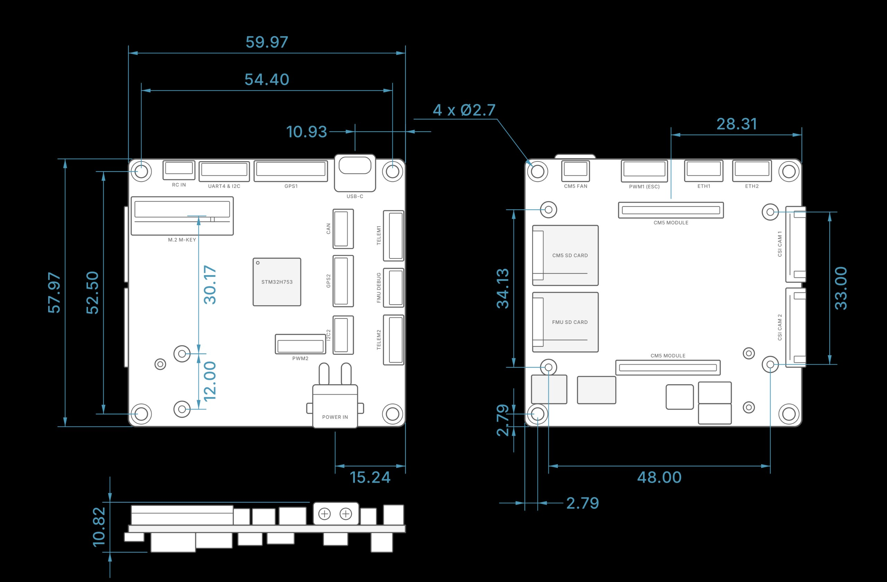

# Dimensions

<svg class="dim-svg" viewBox="0 0 698 681" role="img" aria-label="Pi5 Light Autopilot top view dimensions" xmlns="http://www.w3.org/2000/svg">
<rect class="dim-outline" x="112.0" y="108.0" width="515.7" height="498.5" rx="10.3"/>
<rect class="dim-part" x="116.3" y="178.5" width="190.9" height="71.4" rx="3.4"/>
<text class="dim-part-label" x="249.6" y="192.3" text-anchor="middle" dominant-baseline="middle">M.2 M-KEY</text>
<rect class="dim-part" x="496.4" y="99.4" width="76.5" height="70.5" rx="10.3"/>
<text class="dim-part-label dim-part-label--small" x="534.3" y="137.2" text-anchor="middle" dominant-baseline="middle">USB-C</text>
<rect class="dim-part" x="176.5" y="111.4" width="59.3" height="37.8" rx="3.4"/>
<text class="dim-part-label dim-part-label--small" x="206.2" y="161.3" text-anchor="middle" dominant-baseline="middle">RC IN</text>
<rect class="dim-part" x="243.6" y="111.4" width="94.6" height="37.8" rx="3.4"/>
<text class="dim-part-label dim-part-label--small" x="290.9" y="161.3" text-anchor="middle" dominant-baseline="middle">UART4 &amp; I2C</text>
<rect class="dim-part" x="345.9" y="111.4" width="137.6" height="37.8" rx="3.4"/>
<text class="dim-part-label dim-part-label--small" x="414.7" y="161.3" text-anchor="middle" dominant-baseline="middle">GPS1</text>
<rect class="dim-part" x="493.8" y="201.7" width="37.8" height="73.1" rx="3.4"/>
<text class="dim-part-label dim-part-label--small" x="485.2" y="238.3" text-anchor="middle" dominant-baseline="middle" transform="rotate(-90 485.2 238.3)">CAN</text>
<rect class="dim-part" x="493.8" y="288.6" width="37.8" height="95.5" rx="3.4"/>
<text class="dim-part-label dim-part-label--small" x="485.2" y="336.3" text-anchor="middle" dominant-baseline="middle" transform="rotate(-90 485.2 336.3)">GPS2</text>
<rect class="dim-part" x="493.8" y="400.4" width="37.8" height="72.2" rx="3.4"/>
<text class="dim-part-label dim-part-label--small" x="540.3" y="436.5" text-anchor="middle" dominant-baseline="middle" transform="rotate(-90 540.3 436.5)">I2C2</text>
<rect class="dim-part" x="586.7" y="204.3" width="39.6" height="94.6" rx="3.4"/>
<text class="dim-part-label dim-part-label--small" x="579.0" y="251.6" text-anchor="middle" dominant-baseline="middle" transform="rotate(-90 579.0 251.6)">TELEM1</text>
<rect class="dim-part" x="586.7" y="311.0" width="39.6" height="73.1" rx="3.4"/>
<text class="dim-part-label dim-part-label--small" x="579.0" y="347.5" text-anchor="middle" dominant-baseline="middle" transform="rotate(-90 579.0 347.5)">FMU DEBUG</text>
<rect class="dim-part" x="586.7" y="398.7" width="39.6" height="92.9" rx="3.4"/>
<text class="dim-part-label dim-part-label--small" x="579.0" y="445.1" text-anchor="middle" dominant-baseline="middle" transform="rotate(-90 579.0 445.1)">TELEM2</text>
<rect class="dim-part" x="385.5" y="434.8" width="94.6" height="37.0" rx="3.4"/>
<text class="dim-part-label dim-part-label--small" x="432.8" y="483.8" text-anchor="middle" dominant-baseline="middle">PWM2</text>
<rect class="dim-chip" x="343.3" y="292.9" width="89.4" height="89.4" rx="3.4"/>
<text class="dim-part-label dim-part-label--strong" x="388.1" y="337.6" text-anchor="middle" dominant-baseline="middle">STM32H753</text>
<rect class="dim-part" x="455.1" y="528.5" width="84.3" height="80.8" rx="8.6"/>
<text class="dim-part-label dim-part-label--small" x="497.3" y="576.7" text-anchor="middle" dominant-baseline="middle">POWER IN</text>
<circle class="dim-hole" cx="136.0" cy="583.0" r="11.6"/>
<path class="dim-center" d="M120.3 583.0H151.6M136.0 567.4V598.6"/>
<circle class="dim-hole" cx="603.8" cy="583.0" r="11.6"/>
<path class="dim-center" d="M588.2 583.0H619.4M603.8 567.4V598.6"/>
<circle class="dim-hole" cx="136.0" cy="131.5" r="11.6"/>
<path class="dim-center" d="M120.3 131.5H151.6M136.0 115.9V147.1"/>
<circle class="dim-hole" cx="603.8" cy="131.5" r="11.6"/>
<path class="dim-center" d="M588.2 131.5H619.4M603.8 115.9V147.1"/>
<circle class="dim-hole" cx="210.9" cy="469.8" r="9.5"/>
<path class="dim-center" d="M197.4 469.8H224.4M210.9 456.3V483.3"/>
<circle class="dim-hole" cx="210.9" cy="573.0" r="9.5"/>
<path class="dim-center" d="M197.4 573.0H224.4M210.9 559.5V586.5"/>
<path class="dim-ext" d="M112.0 104.0V38.0"/>
<path class="dim-ext" d="M627.7 104.0V38.0"/>
<path class="dim-line" d="M112.0 44.0H627.7"/>
<path class="dim-arrow" d="M112.0 44.0L119.0 41.4L119.0 46.6Z"/>
<path class="dim-arrow" d="M627.7 44.0L620.7 46.6L620.7 41.4Z"/>
<text class="dim-label" x="369.9" y="39.0" text-anchor="middle">59.97</text>
<path class="dim-ext" d="M136.0 127.5V66.0"/>
<path class="dim-ext" d="M603.8 127.5V66.0"/>
<path class="dim-line" d="M136.0 72.0H603.8"/>
<path class="dim-arrow" d="M136.0 72.0L143.0 69.4L143.0 74.6Z"/>
<path class="dim-arrow" d="M603.8 72.0L596.8 74.6L596.8 69.4Z"/>
<text class="dim-label" x="369.9" y="67.0" text-anchor="middle">54.40</text>
<path class="dim-ext" d="M533.7 95.4V92.0"/>
<path class="dim-ext" d="M627.7 104.0V92.0"/>
<path class="dim-line" d="M533.7 98.0H627.7"/>
<path class="dim-arrow" d="M533.7 98.0L540.7 95.4L540.7 100.6Z"/>
<path class="dim-arrow" d="M627.7 98.0L620.7 100.6L620.7 95.4Z"/>
<text class="dim-label" x="580.7" y="93.0" text-anchor="middle">10.93</text>
<path class="dim-ext" d="M496.7 610.5V652.5"/>
<path class="dim-ext" d="M627.7 610.5V652.5"/>
<path class="dim-line" d="M496.7 646.5H627.7"/>
<path class="dim-arrow" d="M496.7 646.5L503.7 643.9L503.7 649.1Z"/>
<path class="dim-arrow" d="M627.7 646.5L620.7 649.1L620.7 643.9Z"/>
<text class="dim-label" x="562.2" y="641.5" text-anchor="middle">15.24</text>
<path class="dim-ext" d="M108.0 606.5H30.0"/>
<path class="dim-ext" d="M108.0 108.0H30.0"/>
<path class="dim-line" d="M36.0 606.5V108.0"/>
<path class="dim-arrow" d="M36.0 606.5L33.4 599.5L38.6 599.5Z"/>
<path class="dim-arrow" d="M36.0 108.0L38.6 115.0L33.4 115.0Z"/>
<text class="dim-label" x="31.0" y="357.3" text-anchor="middle" transform="rotate(-90 31.0 357.3)">57.97</text>
<path class="dim-ext" d="M132.0 583.0H62.0"/>
<path class="dim-ext" d="M132.0 131.5H62.0"/>
<path class="dim-line" d="M68.0 583.0V131.5"/>
<path class="dim-arrow" d="M68.0 583.0L65.4 576.0L70.6 576.0Z"/>
<path class="dim-arrow" d="M68.0 131.5L70.6 138.5L65.4 138.5Z"/>
<text class="dim-label" x="63.0" y="357.3" text-anchor="middle" transform="rotate(-90 63.0 357.3)">52.50</text>
<path class="dim-ext" d="M214.9 573.0H242.9"/>
<path class="dim-ext" d="M214.9 469.8H242.9"/>
<path class="dim-line" d="M236.9 573.0V469.8"/>
<path class="dim-arrow" d="M236.9 573.0L234.3 566.0L239.5 566.0Z"/>
<path class="dim-arrow" d="M236.9 469.8L239.5 476.8L234.3 476.8Z"/>
<text class="dim-label" x="231.9" y="521.4" text-anchor="middle" transform="rotate(-90 231.9 521.4)">12.00</text>
<path class="dim-ext" d="M214.9 469.8H242.9"/>
<path class="dim-ext" d="M215.8 210.3H242.9"/>
<path class="dim-line" d="M236.9 469.8V210.3"/>
<path class="dim-arrow" d="M236.9 469.8L234.3 462.8L239.5 462.8Z"/>
<path class="dim-arrow" d="M236.9 210.3L239.5 217.3L234.3 217.3Z"/>
<text class="dim-label" x="231.9" y="340.1" text-anchor="middle" transform="rotate(-90 231.9 340.1)">30.17</text>
<text class="dim-label" x="635.7" y="42.0" text-anchor="start">4 × Ø2.7</text>
<text class="dim-note" x="369.9" y="672.5" text-anchor="middle">TOP VIEW · mm</text>
</svg>

<svg class="dim-svg" viewBox="0 0 698 177" role="img" aria-label="Pi5 Light Autopilot side view, overall height" xmlns="http://www.w3.org/2000/svg">
<rect class="dim-part" x="117.2" y="30.2" width="190.1" height="37.8" rx="1.7"/>
<rect class="dim-part" x="308.1" y="36.2" width="29.2" height="31.8" rx="1.7"/>
<rect class="dim-part" x="342.5" y="36.2" width="43.9" height="31.8" rx="1.7"/>
<rect class="dim-part" x="392.4" y="32.8" width="50.7" height="35.3" rx="1.7"/>
<rect class="dim-part" x="456.0" y="24.0" width="85.1" height="44.0" rx="1.7"/>
<rect class="dim-part" x="545.4" y="36.2" width="28.4" height="31.8" rx="1.7"/>
<rect class="dim-part" x="587.6" y="29.3" width="37.8" height="38.7" rx="1.7"/>
<rect class="dim-part" x="115.4" y="79.6" width="25.8" height="17.2" rx="1.7"/>
<rect class="dim-part" x="154.1" y="79.6" width="81.7" height="37.4" rx="1.7"/>
<rect class="dim-part" x="236.7" y="79.6" width="67.9" height="29.2" rx="1.7"/>
<rect class="dim-part" x="316.7" y="79.6" width="44.7" height="24.1" rx="1.7"/>
<rect class="dim-part" x="370.0" y="79.6" width="50.7" height="23.2" rx="1.7"/>
<rect class="dim-part" x="475.8" y="79.6" width="44.7" height="25.8" rx="1.7"/>
<rect class="dim-part" x="563.5" y="79.6" width="42.1" height="37.4" rx="1.7"/>
<rect class="dim-outline" x="112.0" y="68.0" width="515.7" height="11.6" rx="0.9"/>
<path class="dim-ext" d="M113.2 117.1H62.0"/>
<path class="dim-ext" d="M150.1 24.0H62.0"/>
<path class="dim-line" d="M68.0 117.1V24.0"/>
<path class="dim-arrow" d="M68.0 117.1L65.4 110.1L70.6 110.1Z"/>
<path class="dim-arrow" d="M68.0 24.0L70.6 31.0L65.4 31.0Z"/>
<text class="dim-label" x="63.0" y="70.5" text-anchor="middle" transform="rotate(-90 63.0 70.5)">10.82</text>
<text class="dim-note" x="369.9" y="163.1" text-anchor="middle">SIDE VIEW · mm</text>
</svg>

01 Top & Side

| | |
| --- | --- |
| Board size | 59.97 × 57.97 mm |
| Overall height | 10.82 mm |
| Mounting holes | 4 × Ø2.7 mm |
| Mounting hole spacing | 54.40 × 52.50 mm |
| M.2 standoff holes | 12.00 mm apart · 30.17 mm from the M.2 slot |
| USB-C centre | 10.93 mm from the right edge |
| POWER IN (XT30) centre | 15.24 mm from the right edge |
| Weight | 20 g (without CM5 and Hailo) |

All dimensions in mm. Hole spacing is centre to centre. Component outlines are approximate and shown for orientation.

<svg class="dim-svg" viewBox="0 0 720 681" role="img" aria-label="Pi5 Light Autopilot bottom view dimensions" xmlns="http://www.w3.org/2000/svg">
<rect class="dim-outline" x="112.0" y="72.0" width="515.7" height="498.5" rx="10.3"/>
<rect class="dim-part" x="179.9" y="75.4" width="50.7" height="37.8" rx="3.4"/>
<text class="dim-part-label dim-part-label--small" x="205.3" y="125.3" text-anchor="middle" dominant-baseline="middle">CM5 FAN</text>
<rect class="dim-part" x="290.9" y="75.4" width="93.7" height="37.8" rx="3.4"/>
<text class="dim-part-label dim-part-label--small" x="337.8" y="125.3" text-anchor="middle" dominant-baseline="middle">PWM1 (ESC)</text>
<rect class="dim-part" x="409.6" y="75.4" width="71.4" height="37.8" rx="3.4"/>
<text class="dim-part-label dim-part-label--small" x="445.2" y="125.3" text-anchor="middle" dominant-baseline="middle">ETH1</text>
<rect class="dim-part" x="499.0" y="75.4" width="73.1" height="37.8" rx="3.4"/>
<text class="dim-part-label dim-part-label--small" x="535.5" y="125.3" text-anchor="middle" dominant-baseline="middle">ETH2</text>
<rect class="dim-part" x="286.6" y="152.8" width="196.9" height="30.1" rx="3.4"/>
<rect class="dim-part" x="280.6" y="447.8" width="194.4" height="26.7" rx="3.4"/>
<text class="dim-part-label dim-part-label--small" x="385.1" y="195.8" text-anchor="middle" dominant-baseline="middle">CM5 MODULE</text>
<rect class="dim-part" x="124.9" y="195.8" width="123.0" height="111.8" rx="6.9"/>
<text class="dim-part-label" x="186.4" y="251.7" text-anchor="middle" dominant-baseline="middle">CM5 SD</text>
<rect class="dim-part" x="124.9" y="320.5" width="123.0" height="110.9" rx="6.9"/>
<text class="dim-part-label" x="186.4" y="375.6" text-anchor="middle" dominant-baseline="middle">FMU SD</text>
<rect class="dim-part" x="597.9" y="160.6" width="36.1" height="141.0" rx="3.4"/>
<text class="dim-part-label dim-part-label--small" x="581.6" y="231.1" text-anchor="middle" dominant-baseline="middle" transform="rotate(-90 581.6 231.1)">CSI CAM 1</text>
<rect class="dim-part" x="597.9" y="312.8" width="36.1" height="147.1" rx="3.4"/>
<text class="dim-part-label dim-part-label--small" x="581.6" y="386.3" text-anchor="middle" dominant-baseline="middle" transform="rotate(-90 581.6 386.3)">CSI CAM 2</text>
<circle class="dim-hole" cx="136.0" cy="547.0" r="11.6"/>
<path class="dim-center" d="M120.3 547.0H151.6M136.0 531.4V562.6"/>
<circle class="dim-hole" cx="603.8" cy="547.0" r="11.6"/>
<path class="dim-center" d="M588.2 547.0H619.4M603.8 531.4V562.6"/>
<circle class="dim-hole" cx="136.0" cy="95.5" r="11.6"/>
<path class="dim-center" d="M120.3 95.5H151.6M136.0 79.9V111.1"/>
<circle class="dim-hole" cx="603.8" cy="95.5" r="11.6"/>
<path class="dim-center" d="M588.2 95.5H619.4M603.8 79.9V111.1"/>
<circle class="dim-hole" cx="155.0" cy="166.2" r="11.6"/>
<path class="dim-center" d="M139.4 166.2H170.6M155.0 150.6V181.8"/>
<circle class="dim-hole" cx="155.0" cy="459.7" r="11.6"/>
<path class="dim-center" d="M139.4 459.7H170.6M155.0 444.1V475.3"/>
<circle class="dim-hole" cx="567.8" cy="170.5" r="11.6"/>
<path class="dim-center" d="M552.2 170.5H583.4M567.8 154.9V186.1"/>
<circle class="dim-hole" cx="567.8" cy="454.3" r="11.6"/>
<path class="dim-center" d="M552.2 454.3H583.4M567.8 438.7V469.9"/>
<path class="dim-ext" d="M384.3 68.0V36.0"/>
<path class="dim-ext" d="M627.7 68.0V36.0"/>
<path class="dim-line" d="M384.3 42.0H627.7"/>
<path class="dim-arrow" d="M384.3 42.0L391.3 39.4L391.3 44.6Z"/>
<path class="dim-arrow" d="M627.7 42.0L620.7 44.6L620.7 39.4Z"/>
<text class="dim-label" x="506.0" y="37.0" text-anchor="middle">28.31</text>
<path class="dim-ext" d="M155.0 463.7V616.5"/>
<path class="dim-ext" d="M567.8 458.3V616.5"/>
<path class="dim-line" d="M155.0 610.5H567.8"/>
<path class="dim-arrow" d="M155.0 610.5L162.0 607.9L162.0 613.1Z"/>
<path class="dim-arrow" d="M567.8 610.5L560.8 613.1L560.8 607.9Z"/>
<text class="dim-label" x="361.4" y="605.5" text-anchor="middle">48.00</text>
<path class="dim-ext" d="M112.0 574.5V650.5"/>
<path class="dim-ext" d="M136.0 551.0V650.5"/>
<path class="dim-line" d="M112.0 644.5H136.0"/>
<path class="dim-arrow" d="M112.0 644.5L119.0 641.9L119.0 647.1Z"/>
<path class="dim-arrow" d="M136.0 644.5L129.0 647.1L129.0 641.9Z"/>
<text class="dim-label" x="124.0" y="639.5" text-anchor="middle">2.79</text>
<path class="dim-ext" d="M151.0 459.7H66.0"/>
<path class="dim-ext" d="M151.0 166.2H66.0"/>
<path class="dim-line" d="M72.0 459.7V166.2"/>
<path class="dim-arrow" d="M72.0 459.7L69.4 452.7L74.6 452.7Z"/>
<path class="dim-arrow" d="M72.0 166.2L74.6 173.2L69.4 173.2Z"/>
<text class="dim-label" x="67.0" y="312.9" text-anchor="middle" transform="rotate(-90 67.0 312.9)">34.13</text>
<path class="dim-ext" d="M571.8 454.3H679.7"/>
<path class="dim-ext" d="M571.8 170.5H679.7"/>
<path class="dim-line" d="M673.7 454.3V170.5"/>
<path class="dim-arrow" d="M673.7 454.3L671.1 447.3L676.3 447.3Z"/>
<path class="dim-arrow" d="M673.7 170.5L676.3 177.5L671.1 177.5Z"/>
<text class="dim-label" x="668.7" y="312.4" text-anchor="middle" transform="rotate(-90 668.7 312.4)">33.00</text>
<path class="dim-ext" d="M108.0 570.5H30.0"/>
<path class="dim-ext" d="M132.0 547.0H30.0"/>
<path class="dim-line" d="M36.0 570.5V547.0"/>
<path class="dim-arrow" d="M36.0 570.5L33.4 563.5L38.6 563.5Z"/>
<path class="dim-arrow" d="M36.0 547.0L38.6 554.0L33.4 554.0Z"/>
<text class="dim-label" x="31.0" y="558.8" text-anchor="middle" transform="rotate(-90 31.0 558.8)">2.79</text>
<text class="dim-note" x="369.9" y="672.5" text-anchor="middle">BOTTOM VIEW · mm</text>
</svg>

02 Bottom

| | |
| --- | --- |
| CM5 mounting holes | 48.00 mm apart (X) |
| CM5 hole spacing (Y) | 34.13 mm (left) · 33.00 mm (right) |
| CM5 module centre | 28.31 mm from the right edge |
| Corner hole offset | 2.79 mm from the board edge |

All dimensions in mm, bottom side viewed directly. Hole spacing is centre to centre.

??? abstract "Full mechanical drawing"

    
