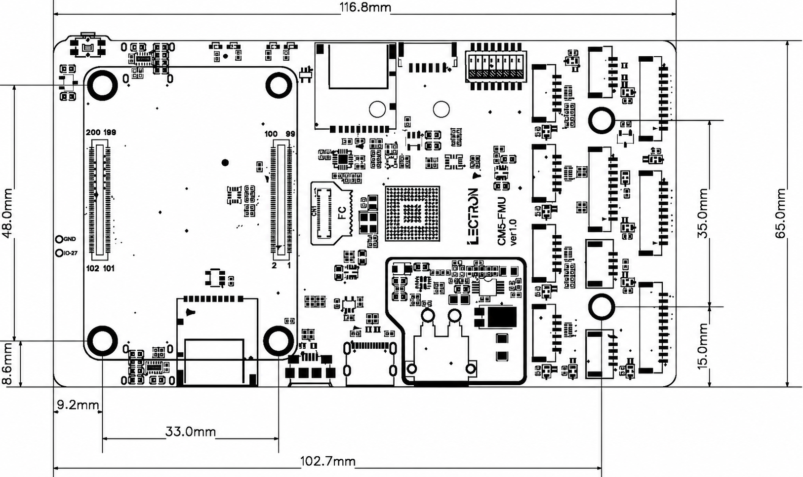
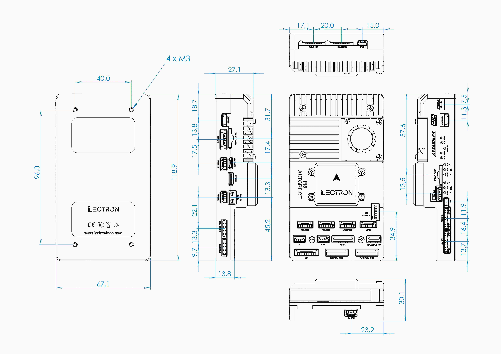

# Dimensions

<svg class="dim-svg" viewBox="0 0 625 415" role="img" aria-label="Pi5 Autopilot board dimensions, top view" xmlns="http://www.w3.org/2000/svg">
  <rect class="dim-outline" x="60.0" y="46.0" width="490.6" height="273.0" rx="10.5"/>
  <rect class="dim-module" x="83.9" y="66.6" width="168.0" height="231.0" rx="8.4"/>
  <rect class="dim-pins" x="88.1" y="125.8" width="17.2" height="88.2" rx="1.3"/>
  <rect class="dim-pins" x="230.9" y="125.8" width="17.2" height="88.2" rx="1.3"/>
  <text class="dim-part-label dim-part-label--strong" x="167.9" y="151.0" text-anchor="middle" dominant-baseline="middle">CM5</text>
  <text class="dim-part-label" x="167.9" y="169.9" text-anchor="middle" dominant-baseline="middle">2 × 100-PIN</text>
  <rect class="dim-part" x="157.0" y="262.3" width="63.0" height="56.7" rx="2.5"/>
  <text class="dim-part-label" x="188.5" y="290.4" text-anchor="middle" dominant-baseline="middle">CM5 SD</text>
  <rect class="dim-part" x="265.8" y="46.0" width="63.4" height="71.0" rx="2.5"/>
  <text class="dim-part-label" x="297.5" y="81.7" text-anchor="middle" dominant-baseline="middle">FMU SD</text>
  <rect class="dim-chip" x="321.2" y="159.4" width="42.8" height="44.9" rx="1.7"/>
  <text class="dim-part-label dim-part-label--strong" x="342.7" y="177.9" text-anchor="middle" dominant-baseline="middle">FMU</text>
  <text class="dim-part-label" x="342.7" y="214.8" text-anchor="middle" dominant-baseline="middle">STM32H753</text>
  <rect class="dim-part" x="385.5" y="52.7" width="44.5" height="25.2" rx="1.7"/>
  <text class="dim-part-label dim-part-label--small" x="407.8" y="89.7" text-anchor="middle" dominant-baseline="middle">DIP SWITCH</text>
  <rect class="dim-module" x="322.5" y="230.8" width="109.6" height="86.1" rx="8.4"/>
  <text class="dim-part-label" x="377.3" y="273.6" text-anchor="middle" dominant-baseline="middle">POWER</text>
  <rect class="dim-part" x="435.9" y="64.5" width="21.4" height="46.6" rx="1.7"/>
  <rect class="dim-part" x="435.9" y="126.6" width="21.4" height="46.6" rx="1.7"/>
  <rect class="dim-part" x="435.9" y="190.5" width="21.4" height="44.9" rx="1.7"/>
  <rect class="dim-part" x="435.9" y="253.1" width="21.4" height="46.6" rx="1.7"/>
  <rect class="dim-part" x="480.8" y="50.6" width="21.4" height="40.7" rx="1.7"/>
  <rect class="dim-part" x="480.8" y="130.4" width="21.4" height="65.9" rx="1.7"/>
  <rect class="dim-part" x="480.8" y="202.2" width="21.4" height="39.1" rx="1.7"/>
  <rect class="dim-part" x="480.8" y="274.5" width="21.4" height="38.6" rx="1.7"/>
  <rect class="dim-part" x="521.6" y="56.5" width="23.5" height="68.0" rx="1.7"/>
  <rect class="dim-part" x="521.6" y="151.8" width="23.5" height="62.2" rx="1.7"/>
  <rect class="dim-part" x="521.6" y="235.4" width="23.5" height="73.9" rx="1.7"/>
  <text class="dim-part-label dim-part-label--small" x="490.1" y="35.1" text-anchor="middle" dominant-baseline="middle">JST-GH PORTS</text>
  <circle class="dim-hole" cx="98.6" cy="282.9" r="5.7"/>
  <path class="dim-center" d="M89.0 282.9H108.3M98.6 273.2V292.6"/>
  <circle class="dim-hole" cx="98.6" cy="81.3" r="5.7"/>
  <path class="dim-center" d="M89.0 81.3H108.3M98.6 71.6V91.0"/>
  <circle class="dim-hole" cx="237.2" cy="282.9" r="5.7"/>
  <path class="dim-center" d="M227.6 282.9H246.9M237.2 273.2V292.6"/>
  <circle class="dim-hole" cx="237.2" cy="81.3" r="5.7"/>
  <path class="dim-center" d="M227.6 81.3H246.9M237.2 71.6V91.0"/>
  <circle class="dim-hole" cx="491.3" cy="256.0" r="6.7"/>
  <path class="dim-center" d="M480.6 256.0H502.1M491.3 245.3V266.7"/>
  <circle class="dim-hole" cx="491.3" cy="109.0" r="6.7"/>
  <path class="dim-center" d="M480.6 109.0H502.1M491.3 98.3V119.7"/>
  <path class="dim-ext" d="M60.0 42.0V18.0"/>
  <path class="dim-ext" d="M550.6 42.0V18.0"/>
  <path class="dim-line" d="M60.0 24.0H550.6"/>
  <path class="dim-arrow" d="M60.0 24.0L67.0 21.4L67.0 26.6Z"/>
  <path class="dim-arrow" d="M550.6 24.0L543.6 26.6L543.6 21.4Z"/>
  <text class="dim-label" x="305.3" y="19.0" text-anchor="middle">116.8</text>
  <path class="dim-ext" d="M554.6 319.0H608.6"/>
  <path class="dim-ext" d="M554.6 46.0H608.6"/>
  <path class="dim-line" d="M602.6 319.0V46.0"/>
  <path class="dim-arrow" d="M602.6 319.0L600.0 312.0L605.2 312.0Z"/>
  <path class="dim-arrow" d="M602.6 46.0L605.2 53.0L600.0 53.0Z"/>
  <text class="dim-label" x="597.6" y="182.5" text-anchor="middle" transform="rotate(-90 597.6 182.5)">65.0</text>
  <path class="dim-ext" d="M495.3 256.0H580.6"/>
  <path class="dim-ext" d="M495.3 109.0H580.6"/>
  <path class="dim-line" d="M574.6 256.0V109.0"/>
  <path class="dim-arrow" d="M574.6 256.0L572.0 249.0L577.2 249.0Z"/>
  <path class="dim-arrow" d="M574.6 109.0L577.2 116.0L572.0 116.0Z"/>
  <text class="dim-label" x="569.6" y="182.5" text-anchor="middle" transform="rotate(-90 569.6 182.5)">35.0</text>
  <path class="dim-ext" d="M94.6 282.9H20.0"/>
  <path class="dim-ext" d="M94.6 81.3H20.0"/>
  <path class="dim-line" d="M26.0 282.9V81.3"/>
  <path class="dim-arrow" d="M26.0 282.9L23.4 275.9L28.6 275.9Z"/>
  <path class="dim-arrow" d="M26.0 81.3L28.6 88.3L23.4 88.3Z"/>
  <text class="dim-label" x="21.0" y="182.1" text-anchor="middle" transform="rotate(-90 21.0 182.1)">48.0</text>
  <path class="dim-ext" d="M94.6 319.0H42.0"/>
  <path class="dim-ext" d="M56.0 282.9H42.0"/>
  <path class="dim-line" d="M48.0 319.0V282.9"/>
  <path class="dim-arrow" d="M48.0 319.0L45.4 312.0L50.6 312.0Z"/>
  <path class="dim-arrow" d="M48.0 282.9L50.6 289.9L45.4 289.9Z"/>
  <text class="dim-label" x="43.0" y="300.9" text-anchor="middle" transform="rotate(-90 43.0 300.9)">8.6</text>
  <path class="dim-ext" d="M60.0 323.0V345.0"/>
  <path class="dim-ext" d="M98.6 286.9V345.0"/>
  <path class="dim-line" d="M60.0 339.0H98.6"/>
  <path class="dim-arrow" d="M60.0 339.0L67.0 336.4L67.0 341.6Z"/>
  <path class="dim-arrow" d="M98.6 339.0L91.6 341.6L91.6 336.4Z"/>
  <text class="dim-label" x="79.3" y="334.0" text-anchor="middle">9.2</text>
  <path class="dim-ext" d="M98.6 286.9V345.0"/>
  <path class="dim-ext" d="M237.2 286.9V345.0"/>
  <path class="dim-line" d="M98.6 339.0H237.2"/>
  <path class="dim-arrow" d="M98.6 339.0L105.6 336.4L105.6 341.6Z"/>
  <path class="dim-arrow" d="M237.2 339.0L230.2 341.6L230.2 336.4Z"/>
  <text class="dim-label" x="167.9" y="334.0" text-anchor="middle">33.0</text>
  <path class="dim-ext" d="M60.0 323.0V377.0"/>
  <path class="dim-ext" d="M491.3 260.0V377.0"/>
  <path class="dim-line" d="M60.0 371.0H491.3"/>
  <path class="dim-arrow" d="M60.0 371.0L67.0 368.4L67.0 373.6Z"/>
  <path class="dim-arrow" d="M491.3 371.0L484.3 373.6L484.3 368.4Z"/>
  <text class="dim-label" x="275.7" y="366.0" text-anchor="middle">102.7</text>
  <text class="dim-note" x="305.3" y="405.0" text-anchor="middle">TOP VIEW · mm</text>
</svg>

01 Board

| | |
| --- | --- |
| Board size | 116.8 × 65.0 mm |
| CM5 mounting holes | 33.0 × 48.0 mm |
| CM5 hole offset from board edge | 9.2 mm (X) · 8.6 mm (Y) |
| Side mounting holes | 2, 35.0 mm apart |
| Side hole position | 102.7 mm (X) · 15.0 mm (Y) |

All dimensions in mm, measured from the bottom-left board corner. Hole spacing is centre to centre. Component outlines are approximate and shown for orientation.

<svg class="dim-svg" viewBox="0 0 640 543" role="img" aria-label="Pi5 Autopilot case dimensions, top and side view" xmlns="http://www.w3.org/2000/svg">
  <rect class="dim-outline" x="104.0" y="64.0" width="232.8" height="412.5" rx="10.4"/>
  <rect class="dim-pins" x="112.7" y="70.9" width="7.6" height="50.3" rx="1.4"/>
  <rect class="dim-pins" x="131.1" y="70.9" width="7.6" height="50.3" rx="1.4"/>
  <rect class="dim-pins" x="149.4" y="70.9" width="7.6" height="50.3" rx="1.4"/>
  <rect class="dim-pins" x="167.8" y="70.9" width="7.6" height="50.3" rx="1.4"/>
  <rect class="dim-pins" x="186.2" y="70.9" width="7.6" height="50.3" rx="1.4"/>
  <rect class="dim-pins" x="204.6" y="70.9" width="7.6" height="50.3" rx="1.4"/>
  <rect class="dim-pins" x="223.0" y="70.9" width="7.6" height="50.3" rx="1.4"/>
  <rect class="dim-pins" x="241.4" y="70.9" width="7.6" height="50.3" rx="1.4"/>
  <rect class="dim-pins" x="259.8" y="70.9" width="7.6" height="50.3" rx="1.4"/>
  <rect class="dim-pins" x="278.2" y="70.9" width="7.6" height="50.3" rx="1.4"/>
  <rect class="dim-pins" x="296.6" y="70.9" width="7.6" height="50.3" rx="1.4"/>
  <rect class="dim-pins" x="314.9" y="70.9" width="7.6" height="50.3" rx="1.4"/>
  <rect class="dim-part" x="231.0" y="123.3" width="105.8" height="105.5" rx="3.5"/>
  <circle class="dim-part" cx="283.9" cy="176.1" r="39.9"/>
  <text class="dim-part-label" x="283.9" y="176.1" text-anchor="middle" dominant-baseline="middle">FAN</text>
  <rect class="dim-part dim-part--raised" x="150.5" y="235.0" width="142.6" height="110.0" rx="5.2"/>
  <text class="dim-part-label dim-part-label--strong" x="221.8" y="290.0" text-anchor="middle" dominant-baseline="middle">MODULE COVER</text>
  <circle class="dim-hidden" cx="151.0" cy="436.8" r="5.6"/>
  <path class="dim-center" d="M141.5 436.8H160.6M151.0 427.2V446.3"/>
  <circle class="dim-hidden" cx="151.0" cy="103.7" r="5.6"/>
  <path class="dim-center" d="M141.5 103.7H160.6M151.0 94.2V113.3"/>
  <circle class="dim-hidden" cx="289.8" cy="436.8" r="5.6"/>
  <path class="dim-center" d="M280.2 436.8H299.3M289.8 427.2V446.3"/>
  <circle class="dim-hidden" cx="289.8" cy="103.7" r="5.6"/>
  <path class="dim-center" d="M280.2 103.7H299.3M289.8 94.2V113.3"/>
  <path class="dim-ext" d="M151.0 99.7V18.0"/>
  <path class="dim-ext" d="M289.8 99.7V18.0"/>
  <path class="dim-line" d="M151.0 24.0H289.8"/>
  <path class="dim-arrow" d="M151.0 24.0L158.0 21.4L158.0 26.6Z"/>
  <path class="dim-arrow" d="M289.8 24.0L282.8 26.6L282.8 21.4Z"/>
  <text class="dim-label" x="220.4" y="19.0" text-anchor="middle">40.0</text>
  <path class="dim-ext" d="M104.0 480.5V512.5"/>
  <path class="dim-ext" d="M336.8 480.5V512.5"/>
  <path class="dim-line" d="M104.0 506.5H336.8"/>
  <path class="dim-arrow" d="M104.0 506.5L111.0 503.9L111.0 509.1Z"/>
  <path class="dim-arrow" d="M336.8 506.5L329.8 509.1L329.8 503.9Z"/>
  <text class="dim-label" x="220.4" y="501.5" text-anchor="middle">67.1</text>
  <path class="dim-ext" d="M147.0 436.8H68.0"/>
  <path class="dim-ext" d="M147.0 103.7H68.0"/>
  <path class="dim-line" d="M74.0 436.8V103.7"/>
  <path class="dim-arrow" d="M74.0 436.8L71.4 429.8L76.6 429.8Z"/>
  <path class="dim-arrow" d="M74.0 103.7L76.6 110.7L71.4 110.7Z"/>
  <text class="dim-label" x="69.0" y="270.3" text-anchor="middle" transform="rotate(-90 69.0 270.3)">96.0</text>
  <path class="dim-ext" d="M100.0 476.5H32.0"/>
  <path class="dim-ext" d="M100.0 64.0H32.0"/>
  <path class="dim-line" d="M38.0 476.5V64.0"/>
  <path class="dim-arrow" d="M38.0 476.5L35.4 469.5L40.6 469.5Z"/>
  <path class="dim-arrow" d="M38.0 64.0L40.6 71.0L35.4 71.0Z"/>
  <text class="dim-label" x="33.0" y="270.3" text-anchor="middle" transform="rotate(-90 33.0 270.3)">118.9</text>
  <path class="dim-ext" d="M289.8 436.8L346.8 466.8H406.8"/>
  <text class="dim-label" x="348.8" y="462.8" text-anchor="start">4 × M3</text>
  <text class="dim-note" x="220.4" y="534.5" text-anchor="middle">TOP VIEW · mm</text>
  <path class="dim-outline" d="M475.6 476.5L523.4 476.5L523.4 345.0L580.0 345.0L580.0 235.0L569.6 235.0L569.6 64.0L475.6 64.0Z"/>
  <path class="dim-ext" d="M475.6 480.5V512.5"/>
  <path class="dim-ext" d="M523.4 480.5V512.5"/>
  <path class="dim-line" d="M475.6 506.5H523.4"/>
  <path class="dim-arrow" d="M475.6 506.5L482.6 503.9L482.6 509.1Z"/>
  <path class="dim-arrow" d="M523.4 506.5L516.4 509.1L516.4 503.9Z"/>
  <text class="dim-label" x="499.5" y="501.5" text-anchor="middle">13.8</text>
  <path class="dim-ext" d="M475.6 60.0V44.0"/>
  <path class="dim-ext" d="M569.6 60.0V44.0"/>
  <path class="dim-line" d="M475.6 50.0H569.6"/>
  <path class="dim-arrow" d="M475.6 50.0L482.6 47.4L482.6 52.6Z"/>
  <path class="dim-arrow" d="M569.6 50.0L562.6 52.6L562.6 47.4Z"/>
  <text class="dim-label" x="522.6" y="45.0" text-anchor="middle">27.1</text>
  <path class="dim-ext" d="M475.6 231.0V14.0"/>
  <path class="dim-ext" d="M580.0 231.0V14.0"/>
  <path class="dim-line" d="M475.6 20.0H580.0"/>
  <path class="dim-arrow" d="M475.6 20.0L482.6 17.4L482.6 22.6Z"/>
  <path class="dim-arrow" d="M580.0 20.0L573.0 22.6L573.0 17.4Z"/>
  <text class="dim-label" x="527.8" y="15.0" text-anchor="middle">30.1</text>
  <text class="dim-note" x="527.8" y="534.5" text-anchor="middle">SIDE VIEW</text>
</svg>

02 Case

| | |
| --- | --- |
| Case size (W × L × H) | 67.1 × 118.9 × 30.1 mm |
| Case height | 13.8 mm (connector end) · 27.1 mm (heatsink) |
| Height incl. module cover | 30.1 mm |
| Mounting holes | 4 × M3 |
| Mounting hole spacing | 40.0 × 96.0 mm |
| Weight | 147.6 g (without CM5 and Hailo) |

All dimensions in mm. Hole spacing is centre to centre. Mounting holes are on the bottom face (dashed in the top view); cover, fan and fin outlines are approximate.

??? abstract "Full mechanical drawing"

    
01 Board

    { .dim-raster }

    
02 Case

    { .dim-raster }
