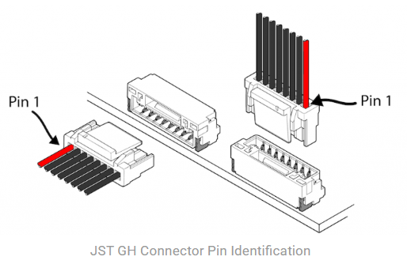
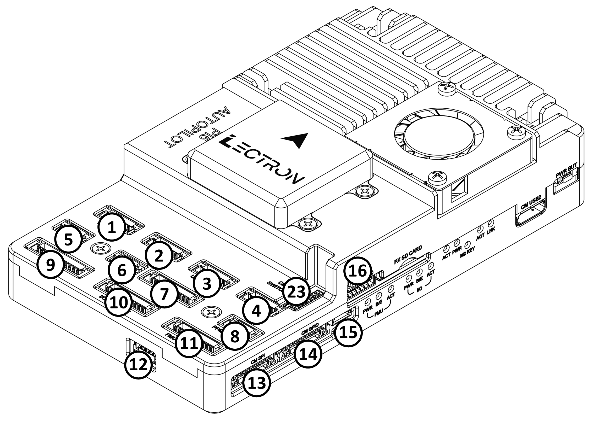
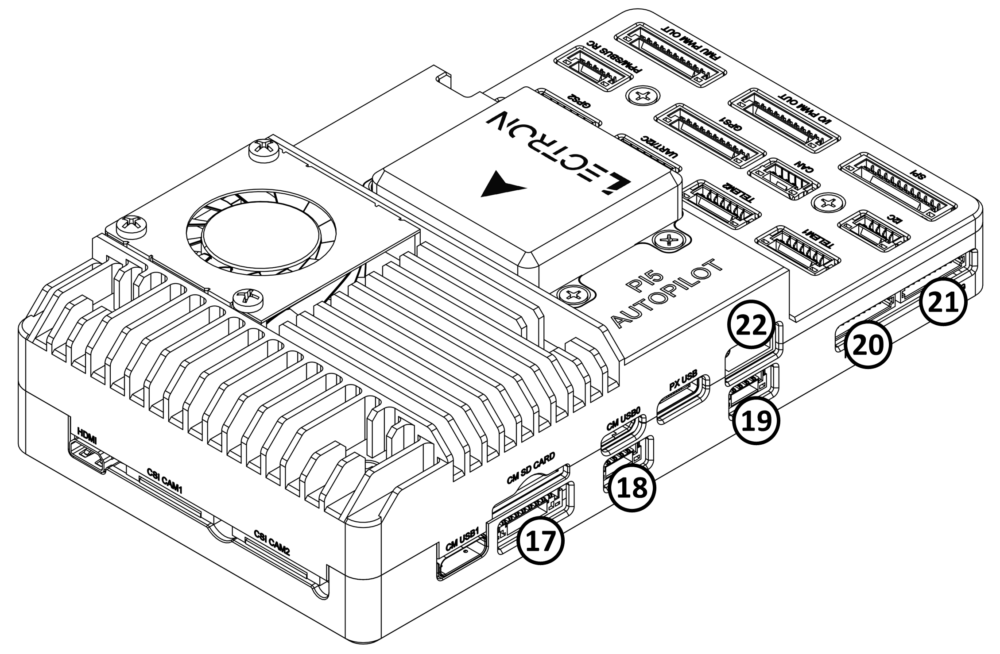

# Pinout

This page describes every external connector on the **Lectron Pi5 Autopilot** baseboard: where it is, its connector type, pin assignment and signal levels. Connectors are numbered as in the views below; each number has a matching pinout.

!!! note "Voltage Legend"
    All logic signals are **+3.3V** unless noted otherwise.

    | Symbol | Meaning |
    | :----: | :------ |
    | `+5V` | Peripheral / system 5V rail |
    | `+3.3V` | Logic-level signal (3.3V) |
    | `9-26V` | Main power input range |
    | `0-16V` | Servo rail sense (depends on BEC) |
    | `GND` | Ground |
    | `---` | Not connected / no defined level |

!!! danger "Warning"
    Most logic pins are **3.3V tolerant only**. Do **not** apply 5V logic levels to signal pins, and never source servo/motor power from the peripheral 5V rail.

!!! warning "Power Budget"
    The peripheral 5V rail is shared across all connectors on each side. The **total current** drawn from all **FMU ports** combined must not exceed **1.5 A**. The same **1.5 A** total limit applies to all **CM5 ports** combined. Budget the current across connected peripherals accordingly.

Click a numbered port in the views or one of the buttons below. Pin 1 is drawn as a square; hover a table row to highlight that pin on the connector.

!!! note "Pin 1 Identification"
    On every connector, **Pin 1** is the first row of the table and the square in the connector strip. Use the image below to locate Pin 1 on the physical JST GH connector before wiring.

    { width="420" }

<figure markdown>

{ .lc-drawing }

<figcaption>Front · connectors 1-16, 23</figcaption>
</figure>

<figure markdown>

{ .lc-drawing }

<figcaption>Back · connectors 17-22</figcaption>
</figure>

<nav class="pin-index" aria-label="Connectors">
<a href="#conn-01" data-conn="01"><b>01</b> TELEM1</a>
<a href="#conn-02" data-conn="02"><b>02</b> TELEM2</a>
<a href="#conn-03" data-conn="03"><b>03</b> UART/I2C</a>
<a href="#conn-04" data-conn="04"><b>04</b> GPS2</a>
<a href="#conn-05" data-conn="05"><b>05</b> I2C</a>
<a href="#conn-06" data-conn="06"><b>06</b> CAN</a>
<a href="#conn-07" data-conn="07"><b>07</b> GPS1</a>
<a href="#conn-08" data-conn="08"><b>08</b> PPM/SBUS RC</a>
<a href="#conn-09" data-conn="09"><b>09</b> SPI</a>
<a href="#conn-10" data-conn="10"><b>10</b> I/O PWM OUT</a>
<a href="#conn-11" data-conn="11"><b>11</b> FMU PWM OUT</a>
<a href="#conn-12" data-conn="12"><b>12</b> CM CAN</a>
<a href="#conn-13" data-conn="13"><b>13</b> CM SPI / PWM</a>
<a href="#conn-14" data-conn="14"><b>14</b> CM GPIO / UART</a>
<a href="#conn-15" data-conn="15"><b>15</b> FAN</a>
<a href="#conn-16" data-conn="16"><b>16</b> CM I2C</a>
<a href="#conn-17" data-conn="17"><b>17</b> CM ETH</a>
<a href="#conn-18" data-conn="18"><b>18</b> PX4 ETH</a>
<a href="#conn-19" data-conn="19"><b>19</b> PWR I2C</a>
<a href="#conn-20" data-conn="20"><b>20</b> FMU DEBUG</a>
<a href="#conn-21" data-conn="21"><b>21</b> I/O DEBUG</a>
<a href="#conn-22" data-conn="22"><b>22</b> PWR IN 3S-6S</a>
<a href="#conn-23" data-conn="23"><b>23</b> CM SWITCH</a>
</nav>

<i class="pin-dot pin-dot--power"></i>Power<i class="pin-dot pin-dot--gnd"></i>Ground<i class="pin-dot pin-dot--uart"></i>UART<i class="pin-dot pin-dot--i2c"></i>I2C<i class="pin-dot pin-dot--can"></i>CAN<i class="pin-dot pin-dot--spi"></i>SPI<i class="pin-dot pin-dot--pwm"></i>PWM<i class="pin-dot pin-dot--rc"></i>RC<i class="pin-dot pin-dot--gpio"></i>GPIO<i class="pin-dot pin-dot--debug"></i>Debug<i class="pin-dot pin-dot--eth"></i>Ethernet<i class="pin-dot pin-dot--one pin-dot--nc"></i>Pin 1

<section class="pin-sheet" id="conn-01" data-conn="01">

01 · Front view · 6 pin

TELEM1

Connector<b>JST-GH · 6 pin</b>

Interface<b>UART7</b>

Location<b>Front view</b>

<table class="pin-table">
<thead><tr><th>Pin</th><th>Signal</th><th>Type</th><th>Level</th><th>Description</th></tr></thead>
<tbody>
<tr data-pin="1"><td>1</td><td class="pin-sig">5V</td><td>Power</td><td class="pin-level">5 V</td><td>Peripheral 5V</td></tr>
<tr data-pin="2"><td>2</td><td class="pin-sig">TX</td><td>UART</td><td class="pin-level">3.3 V</td><td>UART7 TX</td></tr>
<tr data-pin="3"><td>3</td><td class="pin-sig">RX</td><td>UART</td><td class="pin-level">3.3 V</td><td>UART7 RX</td></tr>
<tr data-pin="4"><td>4</td><td class="pin-sig">CTS</td><td>UART</td><td class="pin-level">3.3 V</td><td>UART7 CTS</td></tr>
<tr data-pin="5"><td>5</td><td class="pin-sig">RTS</td><td>UART</td><td class="pin-level">3.3 V</td><td>UART7 RTS</td></tr>
<tr data-pin="6"><td>6</td><td class="pin-sig">GND</td><td>Ground</td><td class="pin-level">0 V</td><td>Ground</td></tr>
</tbody>
</table>
</section>
<section class="pin-sheet" id="conn-02" data-conn="02">

02 · Front view · 6 pin

TELEM2

Connector<b>JST-GH · 6 pin</b>

Interface<b>UART5</b>

Location<b>Front view</b>

<table class="pin-table">
<thead><tr><th>Pin</th><th>Signal</th><th>Type</th><th>Level</th><th>Description</th></tr></thead>
<tbody>
<tr data-pin="1"><td>1</td><td class="pin-sig">5V</td><td>Power</td><td class="pin-level">5 V</td><td>Peripheral 5V</td></tr>
<tr data-pin="2"><td>2</td><td class="pin-sig">TX</td><td>UART</td><td class="pin-level">3.3 V</td><td>UART5 TX</td></tr>
<tr data-pin="3"><td>3</td><td class="pin-sig">RX</td><td>UART</td><td class="pin-level">3.3 V</td><td>UART5 RX</td></tr>
<tr data-pin="4"><td>4</td><td class="pin-sig">CTS</td><td>UART</td><td class="pin-level">3.3 V</td><td>UART5 CTS</td></tr>
<tr data-pin="5"><td>5</td><td class="pin-sig">RTS</td><td>UART</td><td class="pin-level">3.3 V</td><td>UART5 RTS</td></tr>
<tr data-pin="6"><td>6</td><td class="pin-sig">GND</td><td>Ground</td><td class="pin-level">0 V</td><td>Ground</td></tr>
</tbody>
</table>
</section>
<section class="pin-sheet" id="conn-03" data-conn="03">

03 · Front view · 6 pin

UART/I2C

Connector<b>JST-GH · 6 pin</b>

Interface<b>UART4 / I2C3</b>

Location<b>Front view</b>

<table class="pin-table">
<thead><tr><th>Pin</th><th>Signal</th><th>Type</th><th>Level</th><th>Description</th></tr></thead>
<tbody>
<tr data-pin="1"><td>1</td><td class="pin-sig">5V</td><td>Power</td><td class="pin-level">5 V</td><td>Peripheral 5V</td></tr>
<tr data-pin="2"><td>2</td><td class="pin-sig">TX</td><td>UART</td><td class="pin-level">3.3 V</td><td>UART4 TX</td></tr>
<tr data-pin="3"><td>3</td><td class="pin-sig">RX</td><td>UART</td><td class="pin-level">3.3 V</td><td>UART4 RX</td></tr>
<tr data-pin="4"><td>4</td><td class="pin-sig">SCL</td><td>I2C</td><td class="pin-level">3.3 V</td><td>I2C3 SCL</td></tr>
<tr data-pin="5"><td>5</td><td class="pin-sig">SDA</td><td>I2C</td><td class="pin-level">3.3 V</td><td>I2C3 SDA</td></tr>
<tr data-pin="6"><td>6</td><td class="pin-sig">GND</td><td>Ground</td><td class="pin-level">0 V</td><td>Ground</td></tr>
</tbody>
</table>
</section>
<section class="pin-sheet" id="conn-04" data-conn="04">

04 · Front view · 6 pin

GPS2

Connector<b>JST-GH · 6 pin</b>

Interface<b>UART8 / I2C2</b>

Location<b>Front view</b>

<table class="pin-table">
<thead><tr><th>Pin</th><th>Signal</th><th>Type</th><th>Level</th><th>Description</th></tr></thead>
<tbody>
<tr data-pin="1"><td>1</td><td class="pin-sig">5V</td><td>Power</td><td class="pin-level">5 V</td><td>Peripheral 5V</td></tr>
<tr data-pin="2"><td>2</td><td class="pin-sig">TX</td><td>UART</td><td class="pin-level">3.3 V</td><td>UART8 TX</td></tr>
<tr data-pin="3"><td>3</td><td class="pin-sig">RX</td><td>UART</td><td class="pin-level">3.3 V</td><td>UART8 RX</td></tr>
<tr data-pin="4"><td>4</td><td class="pin-sig">SCL</td><td>I2C</td><td class="pin-level">3.3 V</td><td>I2C2 SCL</td></tr>
<tr data-pin="5"><td>5</td><td class="pin-sig">SDA</td><td>I2C</td><td class="pin-level">3.3 V</td><td>I2C2 SDA</td></tr>
<tr data-pin="6"><td>6</td><td class="pin-sig">GND</td><td>Ground</td><td class="pin-level">0 V</td><td>Ground</td></tr>
</tbody>
</table>
</section>
<section class="pin-sheet" id="conn-05" data-conn="05">

05 · Front view · 4 pin

I2C

Connector<b>JST-GH · 4 pin</b>

Interface<b>I2C2</b>

Location<b>Front view</b>

<table class="pin-table">
<thead><tr><th>Pin</th><th>Signal</th><th>Type</th><th>Level</th><th>Description</th></tr></thead>
<tbody>
<tr data-pin="1"><td>1</td><td class="pin-sig">5V</td><td>Power</td><td class="pin-level">5 V</td><td>Peripheral 5V</td></tr>
<tr data-pin="2"><td>2</td><td class="pin-sig">SCL</td><td>I2C</td><td class="pin-level">3.3 V</td><td>I2C2 SCL</td></tr>
<tr data-pin="3"><td>3</td><td class="pin-sig">SDA</td><td>I2C</td><td class="pin-level">3.3 V</td><td>I2C2 SDA</td></tr>
<tr data-pin="4"><td>4</td><td class="pin-sig">GND</td><td>Ground</td><td class="pin-level">0 V</td><td>Ground</td></tr>
</tbody>
</table>
</section>
<section class="pin-sheet" id="conn-06" data-conn="06">

06 · Front view · 4 pin

CAN

Connector<b>JST-GH · 4 pin</b>

Interface<b>FMU CAN</b>

Location<b>Front view</b>

<table class="pin-table">
<thead><tr><th>Pin</th><th>Signal</th><th>Type</th><th>Level</th><th>Description</th></tr></thead>
<tbody>
<tr data-pin="1"><td>1</td><td class="pin-sig">5V</td><td>Power</td><td class="pin-level">5 V</td><td>Peripheral 5V</td></tr>
<tr data-pin="2"><td>2</td><td class="pin-sig">CAN-H</td><td>CAN</td><td class="pin-level">3.3 V</td><td>CAN High</td></tr>
<tr data-pin="3"><td>3</td><td class="pin-sig">CAN-L</td><td>CAN</td><td class="pin-level">3.3 V</td><td>CAN Low</td></tr>
<tr data-pin="4"><td>4</td><td class="pin-sig">GND</td><td>Ground</td><td class="pin-level">0 V</td><td>Ground</td></tr>
</tbody>
</table>
</section>
<section class="pin-sheet" id="conn-07" data-conn="07">

07 · Front view · 10 pin

GPS1

Connector<b>JST-GH · 10 pin</b>

Interface<b>USART1 / I2C1</b>

Location<b>Front view</b>

<table class="pin-table">
<thead><tr><th>Pin</th><th>Signal</th><th>Type</th><th>Level</th><th>Description</th></tr></thead>
<tbody>
<tr data-pin="1"><td>1</td><td class="pin-sig">5V</td><td>Power</td><td class="pin-level">5 V</td><td>Peripheral 5V</td></tr>
<tr data-pin="2"><td>2</td><td class="pin-sig">TX</td><td>UART</td><td class="pin-level">3.3 V</td><td>USART1 TX</td></tr>
<tr data-pin="3"><td>3</td><td class="pin-sig">RX</td><td>UART</td><td class="pin-level">3.3 V</td><td>USART1 RX</td></tr>
<tr data-pin="4"><td>4</td><td class="pin-sig">SCL</td><td>I2C</td><td class="pin-level">3.3 V</td><td>I2C1 SCL</td></tr>
<tr data-pin="5"><td>5</td><td class="pin-sig">SDA</td><td>I2C</td><td class="pin-level">3.3 V</td><td>I2C1 SDA</td></tr>
<tr data-pin="6"><td>6</td><td class="pin-sig">SAFETY SW IN</td><td>GPIO</td><td class="pin-level">3.3 V</td><td>Safety Switch In</td></tr>
<tr data-pin="7"><td>7</td><td class="pin-sig">SAFETY LED</td><td>GPIO</td><td class="pin-level">3.3 V</td><td>Safety LED Out</td></tr>
<tr data-pin="8"><td>8</td><td class="pin-sig">FC 3.3V</td><td>Power</td><td class="pin-level">3.3 V</td><td>FMU 3.3V</td></tr>
<tr data-pin="9"><td>9</td><td class="pin-sig">BUZZER(-)</td><td>GPIO</td><td class="pin-level">3.3 V</td><td>Buzzer (−)</td></tr>
<tr data-pin="10"><td>10</td><td class="pin-sig">GND</td><td>Ground</td><td class="pin-level">0 V</td><td>Ground</td></tr>
</tbody>
</table>
</section>
<section class="pin-sheet" id="conn-08" data-conn="08">

08 · Front view · 5 pin

PPM/SBUS RC

Connector<b>JST-GH · 5 pin</b>

Interface<b>RC input</b>

Location<b>Front view</b>

<table class="pin-table">
<thead><tr><th>Pin</th><th>Signal</th><th>Type</th><th>Level</th><th>Description</th></tr></thead>
<tbody>
<tr data-pin="1"><td>1</td><td class="pin-sig">5V</td><td>Power</td><td class="pin-level">5 V</td><td>Peripheral 5V</td></tr>
<tr data-pin="2"><td>2</td><td class="pin-sig">RC IN</td><td>RC</td><td class="pin-level">3.3 V</td><td>PPM / SBUS Input</td></tr>
<tr data-pin="3"><td>3</td><td class="pin-sig">NC</td><td>NC</td><td class="pin-level">—</td><td>Not connected</td></tr>
<tr data-pin="4"><td>4</td><td class="pin-sig">RC OUT</td><td>RC</td><td class="pin-level">3.3 V</td><td>RSSI In / SBUS Out</td></tr>
<tr data-pin="5"><td>5</td><td class="pin-sig">GND</td><td>Ground</td><td class="pin-level">0 V</td><td>Ground</td></tr>
</tbody>
</table>
</section>
<section class="pin-sheet" id="conn-09" data-conn="09">

09 · Front view · 11 pin

SPI

Connector<b>JST-GH · 11 pin</b>

Interface<b>SPI6</b>

Location<b>Front view</b>

<table class="pin-table">
<thead><tr><th>Pin</th><th>Signal</th><th>Type</th><th>Level</th><th>Description</th></tr></thead>
<tbody>
<tr data-pin="1"><td>1</td><td class="pin-sig">5V</td><td>Power</td><td class="pin-level">5 V</td><td>Peripheral 5V</td></tr>
<tr data-pin="2"><td>2</td><td class="pin-sig">SCK</td><td>SPI</td><td class="pin-level">3.3 V</td><td>SPI6 SCK</td></tr>
<tr data-pin="3"><td>3</td><td class="pin-sig">MISO(RX)</td><td>SPI</td><td class="pin-level">3.3 V</td><td>SPI6 MISO (RX)</td></tr>
<tr data-pin="4"><td>4</td><td class="pin-sig">MOSI(TX)</td><td>SPI</td><td class="pin-level">3.3 V</td><td>SPI6 MOSI (TX)</td></tr>
<tr data-pin="5"><td>5</td><td class="pin-sig">NCS-1</td><td>SPI</td><td class="pin-level">3.3 V</td><td>SPI6 NCS-1</td></tr>
<tr data-pin="6"><td>6</td><td class="pin-sig">NCS-2</td><td>SPI</td><td class="pin-level">3.3 V</td><td>SPI6 NCS-2</td></tr>
<tr data-pin="7"><td>7</td><td class="pin-sig">SPI SYNC</td><td>SPI</td><td class="pin-level">3.3 V</td><td>SPIX Sync</td></tr>
<tr data-pin="8"><td>8</td><td class="pin-sig">DRDY-1</td><td>SPI</td><td class="pin-level">3.3 V</td><td>SPI6 DRDY-1</td></tr>
<tr data-pin="9"><td>9</td><td class="pin-sig">DRDY-2</td><td>SPI</td><td class="pin-level">3.3 V</td><td>SPI6 DRDY-2</td></tr>
<tr data-pin="10"><td>10</td><td class="pin-sig">SPI NRST</td><td>SPI</td><td class="pin-level">3.3 V</td><td>SPI6 NRST</td></tr>
<tr data-pin="11"><td>11</td><td class="pin-sig">GND</td><td>Ground</td><td class="pin-level">0 V</td><td>Ground</td></tr>
</tbody>
</table>
</section>
<section class="pin-sheet" id="conn-10" data-conn="10">

10 · Front view · 10 pin

I/O PWM OUT

Connector<b>JST-GH · 10 pin</b>

Interface<b>IO co-processor</b>

Location<b>Front view</b>

<table class="pin-table">
<thead><tr><th>Pin</th><th>Signal</th><th>Type</th><th>Level</th><th>Description</th></tr></thead>
<tbody>
<tr data-pin="1"><td>1</td><td class="pin-sig">VDD SERVO</td><td>Power</td><td class="pin-level">0-16 V</td><td>VDD Servo Sens</td></tr>
<tr data-pin="2"><td>2</td><td class="pin-sig">IO CH-1</td><td>PWM</td><td class="pin-level">3.3 V</td><td>IO PWM CH1</td></tr>
<tr data-pin="3"><td>3</td><td class="pin-sig">IO CH-2</td><td>PWM</td><td class="pin-level">3.3 V</td><td>IO PWM CH2</td></tr>
<tr data-pin="4"><td>4</td><td class="pin-sig">IO CH-3</td><td>PWM</td><td class="pin-level">3.3 V</td><td>IO PWM CH3</td></tr>
<tr data-pin="5"><td>5</td><td class="pin-sig">IO CH-4</td><td>PWM</td><td class="pin-level">3.3 V</td><td>IO PWM CH4</td></tr>
<tr data-pin="6"><td>6</td><td class="pin-sig">IO CH-5</td><td>PWM</td><td class="pin-level">3.3 V</td><td>IO PWM CH5</td></tr>
<tr data-pin="7"><td>7</td><td class="pin-sig">IO CH-6</td><td>PWM</td><td class="pin-level">3.3 V</td><td>IO PWM CH6</td></tr>
<tr data-pin="8"><td>8</td><td class="pin-sig">IO CH-7</td><td>PWM</td><td class="pin-level">3.3 V</td><td>IO PWM CH7</td></tr>
<tr data-pin="9"><td>9</td><td class="pin-sig">IO CH-8</td><td>PWM</td><td class="pin-level">3.3 V</td><td>IO PWM CH8</td></tr>
<tr data-pin="10"><td>10</td><td class="pin-sig">GND</td><td>Ground</td><td class="pin-level">0 V</td><td>Ground</td></tr>
</tbody>
</table>
</section>
<section class="pin-sheet" id="conn-11" data-conn="11">

11 · Front view · 10 pin

FMU PWM OUT

Connector<b>JST-GH · 10 pin</b>

Interface<b>FMU</b>

Location<b>Front view</b>

<table class="pin-table">
<thead><tr><th>Pin</th><th>Signal</th><th>Type</th><th>Level</th><th>Description</th></tr></thead>
<tbody>
<tr data-pin="1"><td>1</td><td class="pin-sig">VDD SERVO</td><td>Power</td><td class="pin-level">0-16 V</td><td>VDD Servo Sens</td></tr>
<tr data-pin="2"><td>2</td><td class="pin-sig">FMU CH-1</td><td>PWM</td><td class="pin-level">3.3 V</td><td>FMU PWM CH1</td></tr>
<tr data-pin="3"><td>3</td><td class="pin-sig">FMU CH-2</td><td>PWM</td><td class="pin-level">3.3 V</td><td>FMU PWM CH2</td></tr>
<tr data-pin="4"><td>4</td><td class="pin-sig">FMU CH-3</td><td>PWM</td><td class="pin-level">3.3 V</td><td>FMU PWM CH3</td></tr>
<tr data-pin="5"><td>5</td><td class="pin-sig">FMU CH-4</td><td>PWM</td><td class="pin-level">3.3 V</td><td>FMU PWM CH4</td></tr>
<tr data-pin="6"><td>6</td><td class="pin-sig">FMU CH-5</td><td>PWM</td><td class="pin-level">3.3 V</td><td>FMU PWM CH5</td></tr>
<tr data-pin="7"><td>7</td><td class="pin-sig">FMU CH-6</td><td>PWM</td><td class="pin-level">3.3 V</td><td>FMU PWM CH6</td></tr>
<tr data-pin="8"><td>8</td><td class="pin-sig">FMU CH-7</td><td>PWM</td><td class="pin-level">3.3 V</td><td>FMU PWM CH7</td></tr>
<tr data-pin="9"><td>9</td><td class="pin-sig">FMU CH-8</td><td>PWM</td><td class="pin-level">3.3 V</td><td>FMU PWM CH8</td></tr>
<tr data-pin="10"><td>10</td><td class="pin-sig">GND</td><td>Ground</td><td class="pin-level">0 V</td><td>Ground</td></tr>
</tbody>
</table>
</section>
<section class="pin-sheet" id="conn-12" data-conn="12">

12 · Front view · 4 pin

CM CAN

Connector<b>JST-GH · 4 pin</b>

Interface<b>MCP2515 on SPI1-CS0</b>

Location<b>Front view</b>

<table class="pin-table">
<thead><tr><th>Pin</th><th>Signal</th><th>Type</th><th>Level</th><th>Description</th></tr></thead>
<tbody>
<tr data-pin="1"><td>1</td><td class="pin-sig">5V</td><td>Power</td><td class="pin-level">5 V</td><td>System 5V</td></tr>
<tr data-pin="2"><td>2</td><td class="pin-sig">CAN-H</td><td>CAN</td><td class="pin-level">3.3 V</td><td>CAN High</td></tr>
<tr data-pin="3"><td>3</td><td class="pin-sig">CAN-L</td><td>CAN</td><td class="pin-level">3.3 V</td><td>CAN Low</td></tr>
<tr data-pin="4"><td>4</td><td class="pin-sig">GND</td><td>Ground</td><td class="pin-level">0 V</td><td>Ground</td></tr>
</tbody>
</table>
</section>
<section class="pin-sheet" id="conn-13" data-conn="13">

13 · Front view · 10 pin

CM SPI / PWM

Connector<b>JST-GH · 10 pin</b>

Interface<b>SPI1 + PWM</b>

Location<b>Front view</b>

<table class="pin-table">
<thead><tr><th>Pin</th><th>Signal</th><th>Type</th><th>Level</th><th>Description</th></tr></thead>
<tbody>
<tr data-pin="1"><td>1</td><td class="pin-sig">5V</td><td>Power</td><td class="pin-level">5 V</td><td>System 5V</td></tr>
<tr data-pin="2"><td>2</td><td class="pin-sig">SCK</td><td>SPI</td><td class="pin-level">3.3 V</td><td>CM5 SPI1 SCLK</td></tr>
<tr data-pin="3"><td>3</td><td class="pin-sig">MISO(RX)</td><td>SPI</td><td class="pin-level">3.3 V</td><td>CM5 SPI1 SIO1 (MISO)</td></tr>
<tr data-pin="4"><td>4</td><td class="pin-sig">MOSI(TX)</td><td>SPI</td><td class="pin-level">3.3 V</td><td>CM5 SPI1 SIO0 (MOSI)</td></tr>
<tr data-pin="5"><td>5</td><td class="pin-sig">CS</td><td>SPI</td><td class="pin-level">3.3 V</td><td>CM5 SPI1 CS1</td></tr>
<tr data-pin="6"><td>6</td><td class="pin-sig">CM5 CH1</td><td>PWM</td><td class="pin-level">3.3 V</td><td>CM5 PWM CH1</td></tr>
<tr data-pin="7"><td>7</td><td class="pin-sig">CM5 CH2</td><td>PWM</td><td class="pin-level">3.3 V</td><td>CM5 PWM CH2</td></tr>
<tr data-pin="8"><td>8</td><td class="pin-sig">CM5 CH3</td><td>PWM</td><td class="pin-level">3.3 V</td><td>CM5 PWM CH3</td></tr>
<tr data-pin="9"><td>9</td><td class="pin-sig">CM5 CH4</td><td>PWM</td><td class="pin-level">3.3 V</td><td>CM5 PWM CH4</td></tr>
<tr data-pin="10"><td>10</td><td class="pin-sig">GND</td><td>Ground</td><td class="pin-level">0 V</td><td>Ground</td></tr>
</tbody>
</table>
</section>
<section class="pin-sheet" id="conn-14" data-conn="14">

14 · Front view · 10 pin

CM GPIO / UART

Connector<b>JST-GH · 10 pin</b>

Interface<b>GPIO / UART2</b>

Location<b>Front view</b>

<table class="pin-table">
<thead><tr><th>Pin</th><th>Signal</th><th>Type</th><th>Level</th><th>Description</th></tr></thead>
<tbody>
<tr data-pin="1"><td>1</td><td class="pin-sig">5V</td><td>Power</td><td class="pin-level">5 V</td><td>System 5V</td></tr>
<tr data-pin="2"><td>2</td><td class="pin-sig">CM5 GPIO22</td><td>GPIO</td><td class="pin-level">3.3 V</td><td>CM5 GPIO22</td></tr>
<tr data-pin="3"><td>3</td><td class="pin-sig">CM5 GPIO23</td><td>GPIO</td><td class="pin-level">3.3 V</td><td>CM5 GPIO23</td></tr>
<tr data-pin="4"><td>4</td><td class="pin-sig">CM5 GPIO24</td><td>GPIO</td><td class="pin-level">3.3 V</td><td>CM5 GPIO24</td></tr>
<tr data-pin="5"><td>5</td><td class="pin-sig">CM5 GPIO25</td><td>GPIO</td><td class="pin-level">3.3 V</td><td>CM5 GPIO25</td></tr>
<tr data-pin="6"><td>6</td><td class="pin-sig">CM5 GPIO26</td><td>GPIO</td><td class="pin-level">3.3 V</td><td>CM5 GPIO26</td></tr>
<tr data-pin="7"><td>7</td><td class="pin-sig">CM5 GPIO27</td><td>GPIO</td><td class="pin-level">3.3 V</td><td>CM5 GPIO27</td></tr>
<tr data-pin="8"><td>8</td><td class="pin-sig">TX</td><td>UART</td><td class="pin-level">3.3 V</td><td>CM5 UART2 TX</td></tr>
<tr data-pin="9"><td>9</td><td class="pin-sig">RX</td><td>UART</td><td class="pin-level">3.3 V</td><td>CM5 UART2 RX</td></tr>
<tr data-pin="10"><td>10</td><td class="pin-sig">GND</td><td>Ground</td><td class="pin-level">0 V</td><td>Ground</td></tr>
</tbody>
</table>
</section>
<section class="pin-sheet" id="conn-15" data-conn="15">

15 · Front view · 4 pin

FAN

Connector<b>JST-SH · 4 pin</b>

Interface<b>PWM fan</b>

Location<b>Front view</b>

<table class="pin-table">
<thead><tr><th>Pin</th><th>Signal</th><th>Type</th><th>Level</th><th>Description</th></tr></thead>
<tbody>
<tr data-pin="1"><td>1</td><td class="pin-sig">5V</td><td>Power</td><td class="pin-level">5 V</td><td>System 5V</td></tr>
<tr data-pin="2"><td>2</td><td class="pin-sig">PWM</td><td>PWM</td><td class="pin-level">3.3 V</td><td>Fan PWM</td></tr>
<tr data-pin="3"><td>3</td><td class="pin-sig">GND</td><td>Ground</td><td class="pin-level">0 V</td><td>Gnd</td></tr>
<tr data-pin="4"><td>4</td><td class="pin-sig">TACHO</td><td>PWM</td><td class="pin-level">3.3 V</td><td>Fan Tacho</td></tr>
</tbody>
</table>
</section>
<section class="pin-sheet" id="conn-16" data-conn="16">

16 · Front view · 6 pin

CM I2C

Connector<b>JST-GH · 6 pin</b>

Interface<b>I2C1 / I2C3</b>

Location<b>Front view</b>

<table class="pin-table">
<thead><tr><th>Pin</th><th>Signal</th><th>Type</th><th>Level</th><th>Description</th></tr></thead>
<tbody>
<tr data-pin="1"><td>1</td><td class="pin-sig">5V</td><td>Power</td><td class="pin-level">5 V</td><td>System 5V</td></tr>
<tr data-pin="2"><td>2</td><td class="pin-sig">SCL(1)</td><td>I2C</td><td class="pin-level">3.3 V</td><td>CM5 I2C1 SCL</td></tr>
<tr data-pin="3"><td>3</td><td class="pin-sig">SDA(1)</td><td>I2C</td><td class="pin-level">3.3 V</td><td>CM5 I2C1 SDA</td></tr>
<tr data-pin="4"><td>4</td><td class="pin-sig">SCL(2)</td><td>I2C</td><td class="pin-level">3.3 V</td><td>CM5 I2C3 SCL</td></tr>
<tr data-pin="5"><td>5</td><td class="pin-sig">SDA(2)</td><td>I2C</td><td class="pin-level">3.3 V</td><td>CM5 I2C3 SDA</td></tr>
<tr data-pin="6"><td>6</td><td class="pin-sig">GND</td><td>Ground</td><td class="pin-level">0 V</td><td>Ground</td></tr>
</tbody>
</table>
</section>
<section class="pin-sheet" id="conn-17" data-conn="17">

17 · Back view · 8 pin

CM ETH

Connector<b>JST-GH · 8 pin</b>

Interface<b>CM5 Ethernet</b>

Location<b>Back view</b>

<table class="pin-table">
<thead><tr><th>Pin</th><th>Signal</th><th>Type</th><th>Level</th><th>Description</th></tr></thead>
<tbody>
<tr data-pin="1"><td>1</td><td class="pin-sig">TX-N(1)</td><td>Ethernet</td><td class="pin-level">—</td><td>Port 1 TX-</td></tr>
<tr data-pin="2"><td>2</td><td class="pin-sig">TX-P(1)</td><td>Ethernet</td><td class="pin-level">—</td><td>Port 1 TX+</td></tr>
<tr data-pin="3"><td>3</td><td class="pin-sig">RX-N(1)</td><td>Ethernet</td><td class="pin-level">—</td><td>Port 1 RX-</td></tr>
<tr data-pin="4"><td>4</td><td class="pin-sig">RX-P(1)</td><td>Ethernet</td><td class="pin-level">—</td><td>Port 1 RX+</td></tr>
<tr data-pin="5"><td>5</td><td class="pin-sig">TX-N(2)</td><td>Ethernet</td><td class="pin-level">—</td><td>Port 2 TX-</td></tr>
<tr data-pin="6"><td>6</td><td class="pin-sig">TX-P(2)</td><td>Ethernet</td><td class="pin-level">—</td><td>Port 2 TX+</td></tr>
<tr data-pin="7"><td>7</td><td class="pin-sig">RX-N(2)</td><td>Ethernet</td><td class="pin-level">—</td><td>Port 2 RX-</td></tr>
<tr data-pin="8"><td>8</td><td class="pin-sig">RX-P(2)</td><td>Ethernet</td><td class="pin-level">—</td><td>Port 2 RX+</td></tr>
</tbody>
</table>
</section>
<section class="pin-sheet" id="conn-18" data-conn="18">

18 · Back view · 4 pin

PX4 ETH

Connector<b>JST-GH · 4 pin</b>

Interface<b>FMU Ethernet</b>

Location<b>Back view</b>

<table class="pin-table">
<thead><tr><th>Pin</th><th>Signal</th><th>Type</th><th>Level</th><th>Description</th></tr></thead>
<tbody>
<tr data-pin="1"><td>1</td><td class="pin-sig">TX-N</td><td>Ethernet</td><td class="pin-level">—</td><td>ETH TX-N</td></tr>
<tr data-pin="2"><td>2</td><td class="pin-sig">TX-P</td><td>Ethernet</td><td class="pin-level">—</td><td>ETH TX-P</td></tr>
<tr data-pin="3"><td>3</td><td class="pin-sig">RX-N</td><td>Ethernet</td><td class="pin-level">—</td><td>ETH RX-N</td></tr>
<tr data-pin="4"><td>4</td><td class="pin-sig">RX-P</td><td>Ethernet</td><td class="pin-level">—</td><td>ETH RX-P</td></tr>
</tbody>
</table>
</section>
<section class="pin-sheet" id="conn-19" data-conn="19">

19 · Back view · 4 pin

PWR I2C

Connector<b>JST-GH · 4 pin</b>

Interface<b>Power monitor</b>

Location<b>Back view</b>

<table class="pin-table">
<thead><tr><th>Pin</th><th>Signal</th><th>Type</th><th>Level</th><th>Description</th></tr></thead>
<tbody>
<tr data-pin="1"><td>1</td><td class="pin-sig">5V</td><td>Power</td><td class="pin-level">5 V</td><td>System 5V</td></tr>
<tr data-pin="2"><td>2</td><td class="pin-sig">SCL</td><td>I2C</td><td class="pin-level">3.3 V</td><td>I2C1 SCL</td></tr>
<tr data-pin="3"><td>3</td><td class="pin-sig">SDA</td><td>I2C</td><td class="pin-level">3.3 V</td><td>I2C1 SDA</td></tr>
<tr data-pin="4"><td>4</td><td class="pin-sig">GND</td><td>Ground</td><td class="pin-level">0 V</td><td>Ground</td></tr>
</tbody>
</table>
</section>
<section class="pin-sheet" id="conn-20" data-conn="20">

20 · Back view · 10 pin

FMU DEBUG

Connector<b>JST-SH · 10 pin</b>

Interface<b>SWD + USART3</b>

Location<b>Back view</b>

<table class="pin-table">
<thead><tr><th>Pin</th><th>Signal</th><th>Type</th><th>Level</th><th>Description</th></tr></thead>
<tbody>
<tr data-pin="1"><td>1</td><td class="pin-sig">FMU 3.3V</td><td>Power</td><td class="pin-level">3.3 V</td><td>FMU VDD 3.3V</td></tr>
<tr data-pin="2"><td>2</td><td class="pin-sig">TX(3)</td><td>UART</td><td class="pin-level">3.3 V</td><td>USART3 TX Debug</td></tr>
<tr data-pin="3"><td>3</td><td class="pin-sig">RX(3)</td><td>UART</td><td class="pin-level">3.3 V</td><td>USART3 RX Debug</td></tr>
<tr data-pin="4"><td>4</td><td class="pin-sig">SWDIO</td><td>Debug</td><td class="pin-level">3.3 V</td><td>FMU SWDIO</td></tr>
<tr data-pin="5"><td>5</td><td class="pin-sig">SWCLK</td><td>Debug</td><td class="pin-level">3.3 V</td><td>FMU SWCLK</td></tr>
<tr data-pin="6"><td>6</td><td class="pin-sig">SCK-EXT</td><td>Debug</td><td class="pin-level">3.3 V</td><td>SPI6 SCK (external 1)</td></tr>
<tr data-pin="7"><td>7</td><td class="pin-sig">NFC-GPIO</td><td>GPIO</td><td class="pin-level">3.3 V</td><td>NFC GPIO</td></tr>
<tr data-pin="8"><td>8</td><td class="pin-sig">PH11-GPIO</td><td>GPIO</td><td class="pin-level">3.3 V</td><td>PH11</td></tr>
<tr data-pin="9"><td>9</td><td class="pin-sig">FMU NRST</td><td>Debug</td><td class="pin-level">3.3 V</td><td>FMU NRST</td></tr>
<tr data-pin="10"><td>10</td><td class="pin-sig">GND</td><td>Ground</td><td class="pin-level">0 V</td><td>Ground</td></tr>
</tbody>
</table>
</section>
<section class="pin-sheet" id="conn-21" data-conn="21">

21 · Back view · 10 pin

I/O DEBUG

Connector<b>JST-SH · 10 pin</b>

Interface<b>SWD + USART1</b>

Location<b>Back view</b>

<table class="pin-table">
<thead><tr><th>Pin</th><th>Signal</th><th>Type</th><th>Level</th><th>Description</th></tr></thead>
<tbody>
<tr data-pin="1"><td>1</td><td class="pin-sig">IO 3.3V</td><td>Power</td><td class="pin-level">3.3 V</td><td>IO VDD 3.3V</td></tr>
<tr data-pin="2"><td>2</td><td class="pin-sig">TX(1)</td><td>UART</td><td class="pin-level">3.3 V</td><td>IO USART1 TX Debug</td></tr>
<tr data-pin="3"><td>3</td><td class="pin-sig">NC</td><td>NC</td><td class="pin-level">—</td><td>Not connected</td></tr>
<tr data-pin="4"><td>4</td><td class="pin-sig">SWDIO</td><td>Debug</td><td class="pin-level">3.3 V</td><td>IO SWDIO</td></tr>
<tr data-pin="5"><td>5</td><td class="pin-sig">SWCLK</td><td>Debug</td><td class="pin-level">3.3 V</td><td>IO SWCLK</td></tr>
<tr data-pin="6"><td>6</td><td class="pin-sig">SWO</td><td>Debug</td><td class="pin-level">3.3 V</td><td>IO SWO</td></tr>
<tr data-pin="7"><td>7</td><td class="pin-sig">SPARE-1</td><td>GPIO</td><td class="pin-level">3.3 V</td><td>IO Spare GPIO1</td></tr>
<tr data-pin="8"><td>8</td><td class="pin-sig">SPARE-2</td><td>GPIO</td><td class="pin-level">3.3 V</td><td>IO Spare GPIO2</td></tr>
<tr data-pin="9"><td>9</td><td class="pin-sig">IO NRST</td><td>Debug</td><td class="pin-level">3.3 V</td><td>IO NRST</td></tr>
<tr data-pin="10"><td>10</td><td class="pin-sig">GND</td><td>Ground</td><td class="pin-level">0 V</td><td>Ground</td></tr>
</tbody>
</table>
</section>
<section class="pin-sheet" id="conn-22" data-conn="22">

22 · Back view · 2 pin

PWR IN 3S-6S

Connector<b>XT30</b>

Interface<b>Main power</b>

Location<b>Back view</b>

<table class="pin-table">
<thead><tr><th>Pin</th><th>Signal</th><th>Type</th><th>Level</th><th>Description</th></tr></thead>
<tbody>
<tr data-pin="1"><td>1</td><td class="pin-sig">+ (9-26V)</td><td>Power</td><td class="pin-level">9-26 V</td><td>Main power input, +9 V to +26 V</td></tr>
<tr data-pin="2"><td>2</td><td class="pin-sig">− (GND)</td><td>Ground</td><td class="pin-level">0 V</td><td>Ground</td></tr>
</tbody>
</table>
</section>
<section class="pin-sheet" id="conn-23" data-conn="23">

23 · Front view · 8 positions

CM SWITCH

Connector<b>8-position DIP switch</b>

Interface<b>CM5 boot &amp; interface options</b>

Location<b>Front view</b>

<table class="pin-table">
<thead><tr><th>#</th><th>Switch</th><th>Type</th><th>Level</th><th>Function</th></tr></thead>
<tbody>
<tr data-pin="1"><td>1</td><td class="pin-sig">Wifi Disable</td><td>Switch</td><td class="pin-level">—</td><td>WiFi disable (active low)</td></tr>
<tr data-pin="2"><td>2</td><td class="pin-sig">Bluetooth Disable</td><td>Switch</td><td class="pin-level">—</td><td>Bluetooth disable (active low)</td></tr>
<tr data-pin="3"><td>3</td><td class="pin-sig">Rpi Boot</td><td>Switch</td><td class="pin-level">—</td><td>RPi boot (eMMC boot disable)</td></tr>
<tr data-pin="4"><td>4</td><td class="pin-sig">EEProm WP</td><td>Switch</td><td class="pin-level">—</td><td>EEPROM write protect (active low)</td></tr>
<tr data-pin="5"><td>5</td><td class="pin-sig">Ethernet Sync</td><td>Switch</td><td class="pin-level">—</td><td>Ethernet sync out</td></tr>
<tr data-pin="6"><td>6</td><td class="pin-sig">USB OTG</td><td>Switch</td><td class="pin-level">—</td><td>USB OTG ID</td></tr>
<tr data-pin="7"><td>7</td><td class="pin-sig">PMIC Enable</td><td>Switch</td><td class="pin-level">—</td><td>PMIC enable</td></tr>
<tr data-pin="8"><td>8</td><td class="pin-sig">Power Button</td><td>Switch</td><td class="pin-level">—</td><td>Power button</td></tr>
</tbody>
</table>
</section>

!!! warning "DSM Support"
    **08 PPM/SBUS RC** does not support DSM receivers.

!!! note "Onboard Power Monitoring"
    The board includes an onboard voltage-sensing module (**INA238**). To also measure current draw or monitor an external battery, connect a compatible I2C power module to **19 PWR I2C**.

!!! note "CM Switch State"
    When the **23 CM SWITCH** levers are toggled toward the **"CM SWITCH"** text, they are in the **PASSIVE/DEFAULT** state. Wifi Disable, Bluetooth Disable and EEProm WP are active low; Rpi Boot disables eMMC boot.

!!! danger "Power Input"
    Observe correct polarity on **22 PWR IN**. Input voltage must stay within **+9V to +26V**; reverse polarity or over-voltage may permanently damage the board. Power the board exclusively through the **XT30 cable supplied by Lectron**: it compensates for voltage ripples caused by the motors, and a third-party or incorrectly wired cable may damage the onboard regulator stage.

## **Other Interfaces**

Unnumbered ports, labelled directly on the case.

| Interface | Connector | Notes |
| :-------- | :-------- | :---- |
| PX USB | USB 2.0 Type-C | FMU firmware flashing and MAVLink over USB |
| CM USB0 / CM USB1 | USB 3.0 Type-C | CM5 host ports |
| CM USB2 | USB 2.0 Micro | CM5 USB 2.0 port |
| HDMI | Micro HDMI | CM5 video output |
| CSI CAM1 / CSI CAM2 | 22-pin FFC, 0.5 mm | MIPI CSI camera / display (pinouts below) |
| M.2 KEY | M.2 M-Key 2230 / 2242 | PCIe Gen2 x1 (NVMe, Hailo-8, DX-M1M) |
| PX SD CARD | microSD | FMU logging |
| CM SD CARD | microSD | CM5 storage (CM5 Lite only) |

??? abstract "CSI camera pinouts"

    **CSI-1 - Camera / Display 0**
    22-pin 0.5mm-pitch FFC carrying MIPI port 0 (4-lane) (**22-pin FFC (0.5mm)**).

    | Pin | Signal | Voltage |
    | :-: | :----- | :-----: |
    |  1  | GROUND  | GND  |
    |  2  | MIPI0_D0_N  | +3.3V  |
    |  3  | MIPI0_D0_P  | +3.3V  |
    |  4  | GROUND  | GND  |
    |  5  | MIPI0_D1_N  | +3.3V  |
    |  6  | MIPI0_D1_P  | +3.3V  |
    |  7  | GROUND  | GND  |
    |  8  | MIPI0_C_N  | +3.3V  |
    |  9  | MIPI0_C_P  | +3.3V  |
    |  10  | GROUND  | GND  |
    |  11  | MIPI0_D2_N  | +3.3V  |
    |  12  | MIPI0_D2_P  | +3.3V  |
    |  13  | GROUND  | GND  |
    |  14  | MIPI0_D3_N  | +3.3V  |
    |  15  | MIPI0_D3_P  | +3.3V  |
    |  16  | GROUND  | GND  |
    |  17  | CAM_GPIO0  | +3.3V  |
    |  18  | CAM_GPIO1  | +3.3V  |
    |  19  | GROUND  | GND  |
    |  20  | CM5_SCL0  | +3.3V  |
    |  21  | CM5_SDA0  | +3.3V  |
    |  22  | CM5 3.3V  | +3.3V  |

    **CSI-2 - Camera / Display 1**
    22-pin 0.5mm-pitch FFC carrying MIPI port 1 (4-lane) (**22-pin FFC (0.5mm)**).

    | Pin | Signal | Voltage |
    | :-: | :----- | :-----: |
    |  1  | GROUND  | GND  |
    |  2  | MIPI1_D0_N  | +3.3V  |
    |  3  | MIPI1_D0_P  | +3.3V  |
    |  4  | GROUND  | GND  |
    |  5  | MIPI1_D1_N  | +3.3V  |
    |  6  | MIPI1_D1_P  | +3.3V  |
    |  7  | GROUND  | GND  |
    |  8  | MIPI1_C_N  | +3.3V  |
    |  9  | MIPI1_C_P  | +3.3V  |
    |  10  | GROUND  | GND  |
    |  11  | MIPI1_D2_N  | +3.3V  |
    |  12  | MIPI1_D2_P  | +3.3V  |
    |  13  | GROUND  | GND  |
    |  14  | MIPI1_D3_N  | +3.3V  |
    |  15  | MIPI1_D3_P  | +3.3V  |
    |  16  | GROUND  | GND  |
    |  17  | CM5 3.3V  | +3.3V  |
    |  18  | NC  | ---  |
    |  19  | GROUND  | GND  |
    |  20  | CM5 ID-SC  | +3.3V  |
    |  21  | CM5 ID-SD  | +3.3V  |
    |  22  | CM5 3.3V  | +3.3V  |

!!! info "Reference"
    Connector layout follows the **Pixhawk Bus Standard** on the FMU side.
